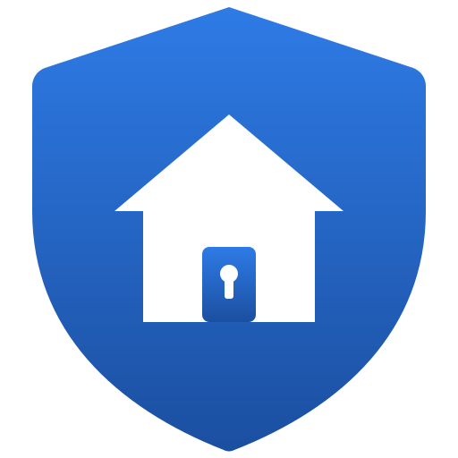
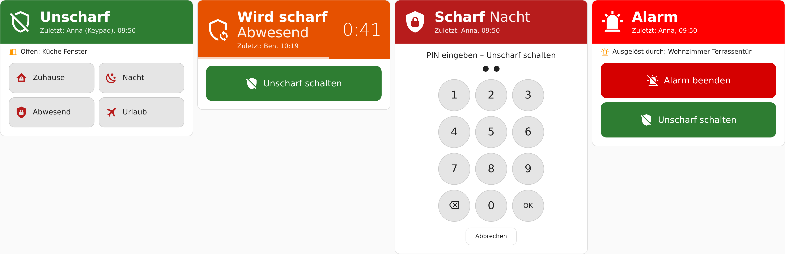
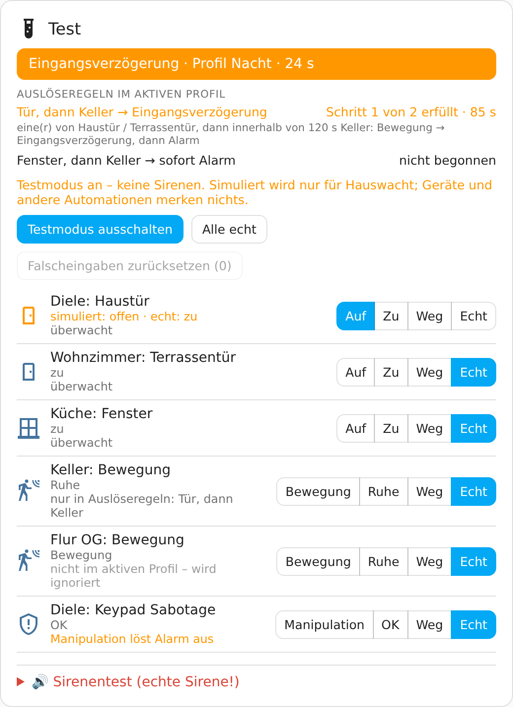
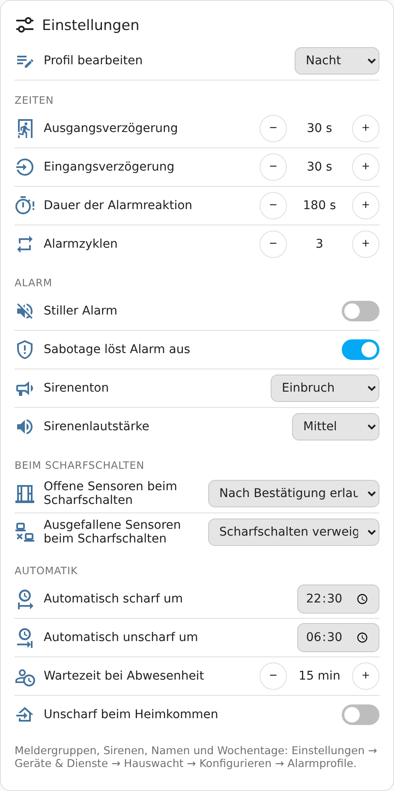

# Hauswacht

[Deutsch](README.md) | **English**

**Intrusion alarm system for Home Assistant** ("Hauswacht" means "house watch") – freely
definable alarm profiles, trigger rules like "door, then basement", users with PIN and RFID card,
Zigbee keypads, sirens with a fire lock, and a test mode in which no siren can go off.

> **Status: 0.48.0 – beta.** In use in my own home; feedback is very welcome. Real siren control
> is **locked** after installation and has to be enabled deliberately.

Everything you see in Home Assistant – setup dialogs, entities, cards, notifications, push
buttons, announcements and reports – is available in **English and German** and follows the
language of Home Assistant. The [documentation](docs/en/README.md) is available in English too.

  

  
  

(The screenshots show the German interface.)

## What Hauswacht can do

- **Alarm profiles instead of fixed modes** – "Home", "Night", "Vacation" … as many as you like,
  each with its own sensor groups, delays, sirens and recipients. Automatic arming by time or when
  everyone has left – with presence from several signals per person (Wi-Fi, Bluetooth, router,
  proximity …) – and disarm on arrival with door proof.
- **Trigger rules** – alarm only on a sequence ("door, then basement within 2 minutes"), with
  exceptions and conditions; in a wizard or as YAML.
- **Alarm card without forced PIN** – a large card for the tablet: state with countdown, one
  button per profile, open sensors with "Arm anyway". Whoever is logged in switches with their own
  rights; it only asks for a PIN where configured – e.g. on the wall tablet in the hallway.
- **Areas** – house and garage armed independently, with their own alarm panel and "All areas".
- **Users and credentials** – PIN and any number of RFID cards per person, rights per area,
  guests with validity, duress PIN with silent emergency call, lockout against guessing.
- **Control devices** – Zigbee keypads via Zigbee2MQTT with feedback on the device, learning
  cards directly at the keypad, NFC stickers with the Home Assistant app, RFID readers, buttons
  (arm only) and door locks (e.g. Nuki: disarm when a known user unlocks).
- **Notifications** – per event with their own recipients and texts, critical alerts break
  through Do Not Disturb, buttons "Disarm" and "Arm anyway" in the push message, announcements
  via speakers (e.g. Echo).
- **Sirens with common sense** – controlled only according to their capabilities, never during a
  fire, a fire tone only as an expert release and never on smoke detectors; tone per siren (e.g.
  Homematic IP alarm siren), sirens on a switch via a wizard; siren test individually, briefly and
  quietly.
- **Honest about faults** – failed sensors, radio silence and outages of Zigbee2MQTT or MQTT are
  made visible instead of hidden.
- **Test mode and test card** – play everything through safely, without siren, without other
  automations noticing.
- **System overview** – the whole configuration at a glance, printable, with an emergency sheet
  for the family and check hints that find gaps and forgotten items.
- **Observe instead of guess** – homecoming and radio silence observation deliver numbers before
  you automate anything.

## Quick start

1. **Add the repository** and download Hauswacht, then restart Home Assistant:
   - **Marketplace** (from Home Assistant 2026.11): Settings → Marketplace → *Add from link* →
     `https://github.com/schlusenbaum/hauswacht`
   - **HACS** (up to 2026.10): HACS → ⋮ → **Custom repositories** →
     `https://github.com/schlusenbaum/hauswacht`, type **Integration**

   Hauswacht is not (yet) in the catalogue, hence the detour via the link –
   [step by step](docs/en/installation.md#installation).
2. Set up Hauswacht:

   

3. **Configure:** add a sensor group with the door and window contacts, add an alarm profile (e.g.
   "Night"), enter your phone as recipient.
4. Put the card **"Hauswacht Test"** on a dashboard, test mode on, play it through.
5. Test mode off – done. Enable sirens only once everything works.

In detail: [Installation and first steps](docs/en/installation.md).

## Documentation

| | |
|---|---|
| [Installation and first steps](docs/en/installation.md) | installation, menu, the first five steps |
| [Sensors and sensor groups](docs/en/sensors.md) | which sensors, types, always active, radio silence |
| [Alarm profiles and areas](docs/en/profiles.md) | profiles, automation, presence, disarm on arrival, arm by closing the door, areas |
| [Trigger rules](docs/en/trigger-rules.md) | sequences, exceptions, conditions, YAML |
| [Operation and dashboard](docs/en/dashboard.md) | arm/disarm, alarm card, ending an alarm, cards |
| [Users, PINs and lockout](docs/en/users.md) | users, rights, PIN rules, duress PIN |
| [Control devices](docs/en/control-devices.md) | keypads, learning cards, NFC, RFID readers, fingerprint, buttons, door locks |
| [Sirens](docs/en/sirens.md) | compatibility, release, tone per siren, siren from switch, siren test, "why didn't it sound?", fire protection |
| [Notifications](docs/en/notifications.md) | events, custom texts, speech |
| [System overview](docs/en/overview.md) | overview, printing, emergency sheet, check hints |
| [Test mode](docs/en/test-mode.md) · [Observations](docs/en/observations.md) · [Reference](docs/en/reference.md) · [Troubleshooting](docs/en/troubleshooting.md) | |

Everything at a glance: [docs/en/](docs/en/README.md).

## Requirements

- Home Assistant **2026.10** or newer
- Sensors with open/closed (door, window, motion sensors …) – independent of the manufacturer
- Optional: sirens (`siren`, or switches via a wizard), Home Assistant app, Zigbee2MQTT for keypads
- No cloud, no other integrations needed

## Safety

- **Fire alarm always has priority:** as long as a smoke detector reports fire or its state is
  unclear, Hauswacht switches no siren on and none off.
- **Test mode locks sirens technically**, not just in the display. The siren release is off after
  installation.
- **After a restart as before** – armed stays armed (configurable: always armed or always
  disarmed); a previous alarm is never continued, sirens never go on because of it – and its own
  sirens that were still sounding at the restart are switched off afterwards.
- **Hauswacht switches no devices** except sirens (including switches added as sirens) and the
  display of configured keypads – a test makes sure of this. Hauswacht only reads door locks, it
  never operates them.

The binding rules: [Safety rules](docs/en/development/safety.md).

> **Note:** Hauswacht is a hobby project and **not a certified security system** (no VdS or EN
> 50131 certification). It replaces neither a professional intrusion alarm system nor tested smoke
> detectors.

## How Hauswacht came about

Hauswacht was built with **a lot of help from AI**: large parts of the code, the tests and the
documentation were written by **Claude** (Anthropic). The ideas, concepts, safety rules and
decisions are mine.

It is tested in two ways: **in my own home with real hardware** – door and window contacts,
motion and presence sensors, a Zigbee keypad and sirens – and additionally with **automated
tests** that every change has to pass before it is merged. The automated tests also play through
cases you would not want to try at home, such as an alarm while a smoke detector reports fire.

Other homes have other devices – that is why feedback from other installations is especially
valuable.

## Contributing

Bugs and wishes are welcome as an [issue](https://github.com/schlusenbaum/hauswacht/issues), in
English or German – feedback on further siren and keypad models is especially welcome. If you want
to work on the code: [safety rules](docs/en/development/safety.md); architecture and
[tests](docs/entwicklung/testing.md) are documented in German for now.

## Support

If you like Hauswacht, I'd be happy about a coffee:

## License

[MIT](LICENSE)
