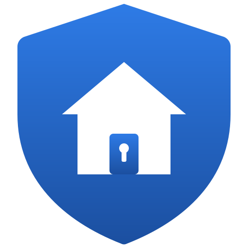
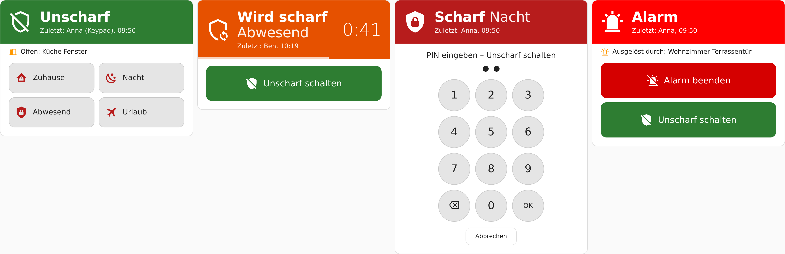
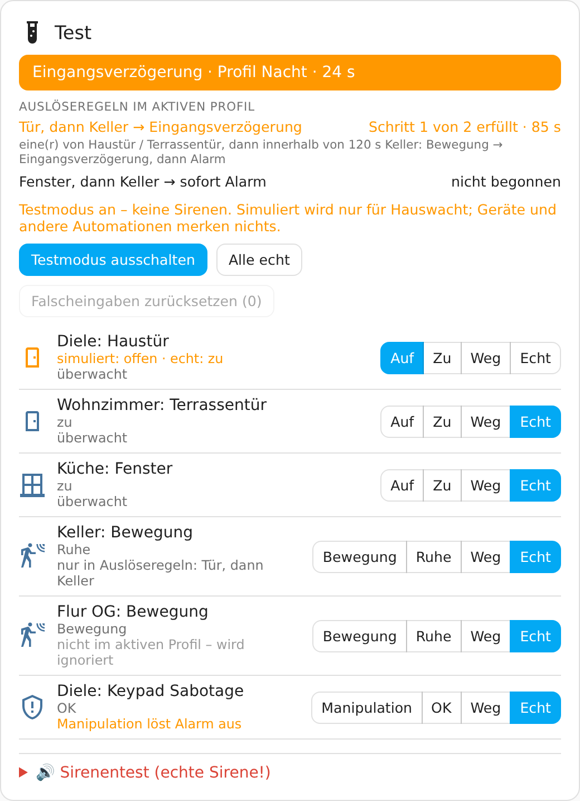
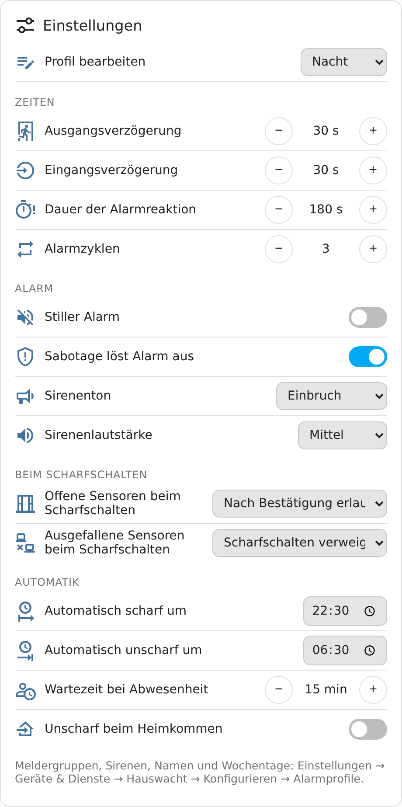

# Hauswacht

**Einbruchmeldeanlage für Home Assistant** – frei definierbare Alarmprofile, Auslöseregeln wie
„Tür, dann Keller“, Benutzer mit PIN und RFID-Karte, Zigbee-Keypads, Sirenen mit Brandsperre
und ein Testmodus, in dem garantiert keine Sirene losgeht.

> **Status: 0.41.1 – Beta.** Im eigenen Haus im Einsatz; Rückmeldungen sind ausdrücklich
> erwünscht. Die echte Sirenenansteuerung ist nach der Installation **gesperrt** und muss bewusst
> freigegeben werden.

<b>English summary</b>

**Hauswacht** ("house watch") is an intrusion alarm system for Home Assistant, currently in
**beta**.

- **Alarm profiles** instead of fixed modes ("Home", "Night", "Vacation" …), each with its own
  sensors, delays, sirens and recipients; automatic arming by time or when everyone has left.
- **Trigger rules** such as "door, then basement within 2 minutes", with exceptions and conditions.
- **Areas** (house, garage …) armed independently.
- **Users** with PIN and any number of RFID cards, rights per area, guests with validity,
  duress PIN, lockout against guessing.
- **Keypads** via Zigbee2MQTT with feedback on the device, NFC tags, RFID readers.
- **Sirens with fire lock:** never sounds or silences a siren while a smoke detector reports fire;
  sirens are locked after installation until you release them.
- **Test mode** that technically blocks sirens, plus a test card to simulate sensors.
- **Dashboard cards:** alarm card (no forced PIN – the logged-in account is the credential),
  settings, test, and a printable system overview with checks.

Everything you see in Home Assistant – setup dialogs, entities, cards, notifications, push
buttons, announcements and reports – is available in **English and German** (following the
language of Home Assistant). The **documentation is German only** for now – a translation is
planned. Installation: add `https://github.com/schlusenbaum/hauswacht` as a custom repository
(Marketplace: *Add from link*; HACS: *Custom repositories*, type *Integration*), download,
restart, then add the integration. Questions and feedback in English are welcome in the
[issues](https://github.com/schlusenbaum/hauswacht/issues).

Not a certified security system – it does not replace a professional alarm system or tested
smoke detectors.

  

  
  

## Was Hauswacht kann

- **Alarmprofile statt fester Modi** – „Zuhause“, „Nacht“, „Urlaub“ … beliebig viele, jedes mit
  eigenen Meldergruppen, Verzögerungen, Sirenen und Empfängern. Automatisch scharf nach Uhrzeit
  oder wenn alle weg sind.
- **Auslöseregeln** – Alarm erst bei einer Abfolge („Tür, dann Keller innerhalb von 2 Minuten“),
  mit Ausnahmen und Bedingungen; im Assistenten oder als YAML.
- **Alarmkarte ohne PIN-Zwang** – große Karte fürs Tablet: Zustand mit Countdown, ein Knopf je
  Profil, offene Melder mit „Trotzdem scharf“. Wer angemeldet ist, schaltet mit seinen Rechten;
  einen PIN verlangt sie nur, wo es eingestellt ist – z. B. am Wandtablet im Flur.
- **Bereiche** – Haus und Garage unabhängig scharf, mit eigenem Bedienfeld und „Alle Bereiche“.
- **Benutzer und Ausweise** – PIN und beliebig viele RFID-Karten je Person, Rechte je Bereich,
  Gäste mit Gültigkeit, Bedrohungs-PIN mit stillem Notruf, Sperre gegen Durchprobieren.
- **Bedienteile** – Zigbee-Keypads über Zigbee2MQTT mit Rückmeldung am Gerät, Karten direkt am
  Keypad anlernen, NFC-Aufkleber mit der Home-Assistant-App, RFID-Leser.
- **Benachrichtigungen** – pro Ereignis mit eigenen Empfängern und Texten, wichtige Hinweise
  durchbrechen „Nicht stören“, Knöpfe „Unscharf schalten“ und „Trotzdem scharf“ in der
  Push-Nachricht, Ansagen über Lautsprecher (z. B. Echo).
- **Sirenen mit Verstand** – angesteuert nur nach ihren Fähigkeiten, nie während eines Brandes,
  ein Brandton nur als Experten-Freigabe und nie an Rauchmeldern; Ton je Sirene (z. B. Homematic
  IP Alarmsirene), Sirenen am Schalter per Assistent; Sirenentest einzeln, kurz und leise.
- **Ehrlich bei Störungen** – ausgefallene Melder, Funkstille und Ausfälle von Zigbee2MQTT oder
  MQTT werden sichtbar statt verschwiegen.
- **Testmodus und Testkarte** – alles gefahrlos durchspielen, ohne Sirene, ohne dass andere
  Automationen etwas merken.
- **Anlagenübersicht** – die ganze Konfiguration auf einen Blick, zum Drucken, mit Notfallblatt
  für die Familie und Prüfhinweisen, die Lücken und Vergessenes finden.
- **Beobachten statt raten** – Heimkehr- und Funkstille-Beobachtung liefern Zahlen, bevor man
  etwas automatisiert.

## Schnellstart

1. **Repository einbinden** und Hauswacht herunterladen, danach Home Assistant neu starten:
   - **Marketplace** (ab Home Assistant 2026.11): Einstellungen → Marketplace → hinzufügen per Link
     (*Add from link*) → `https://github.com/schlusenbaum/hauswacht`
   - **HACS** (bis 2026.10): HACS → ⋮ → **Benutzerdefinierte Repositories** → `https://github.com/schlusenbaum/hauswacht`,
     Typ **Integration**

   Hauswacht steht (noch) nicht im Katalog, daher der Umweg über den Link –
   [Schritt für Schritt](docs/installation.md#installation).
2. Hauswacht einrichten:

   

3. **Konfigurieren:** eine Meldergruppe mit den Tür- und Fensterkontakten anlegen, ein
   Alarmprofil (z. B. „Nacht“) anlegen, das Handy als Empfänger eintragen.
4. Karte **„Hauswacht Test“** aufs Dashboard, Testmodus an, durchspielen.
5. Testmodus aus – fertig. Sirenen erst freigeben, wenn alles passt.

Ausführlich: [Installation und erste Schritte](docs/installation.md).

## Dokumentation

| | |
|---|---|
| [Installation und erste Schritte](docs/installation.md) | Installation, Menü, die ersten fünf Schritte |
| [Melder und Meldergruppen](docs/melder.md) | Welche Sensoren, Typen, immer aktiv, Funkstille |
| [Alarmprofile und Bereiche](docs/profile.md) | Profile, Automatik, Scharf durch Türschließen, Bereiche |
| [Auslöseregeln](docs/ausloeseregeln.md) | Abfolgen, Ausnahmen, Bedingungen, YAML |
| [Bedienung und Dashboard](docs/dashboard.md) | Scharf/unscharf, Alarmkarte, Alarm beenden, Karten |
| [Benutzer, PINs und Sperre](docs/benutzer.md) | Benutzer, Rechte, PIN-Regeln, Bedrohungs-PIN |
| [Bedienteile](docs/bedienteile.md) | Keypads, Karten anlernen, NFC, RFID-Leser |
| [Sirenen](docs/sirenen.md) | Kompatibilität, Freigabe, Ton je Sirene, Sirene aus Schalter, Sirenentest, „Warum hat sie nicht geklingelt?“, Brandschutz |
| [Benachrichtigungen](docs/benachrichtigungen.md) | Ereignisse, eigene Texte, Sprachausgabe |
| [Anlagenübersicht](docs/uebersicht.md) | Übersicht, Drucken, Notfallblatt, Prüfhinweise |
| [Testmodus](docs/testmodus.md) · [Beobachtungen](docs/beobachtung.md) · [Referenz](docs/referenz.md) · [Fehlersuche](docs/fehlersuche.md) | |

Alles auf einen Blick: [docs/](docs/README.md).

## Voraussetzungen

- Home Assistant **2026.10** oder neuer
- Melder mit offen/zu (Tür-, Fenster-, Bewegungsmelder …) – herstellerunabhängig
- Optional: Sirenen (`siren`, oder Schalter über einen Assistenten), Home-Assistant-App, Zigbee2MQTT für Keypads
- Keine Cloud, keine weiteren Integrationen nötig

## Sicherheit

- **Brandalarm hat immer Vorrang:** Solange ein Rauchmelder Brand meldet oder sein Zustand unklar
  ist, schaltet Hauswacht keine Sirene ein und keine aus.
- **Testmodus sperrt Sirenen technisch**, nicht nur in der Anzeige. Die Sirenenfreigabe ist nach
  der Installation aus.
- **Nach einem Neustart unscharf** – ein früherer Alarm wird nie unkontrolliert wieder
  aufgenommen.
- **Hauswacht schaltet keine Geräte** außer Sirenen (auch als Sirene eingetragene Schalter) und
  der Anzeige eingerichteter Keypads – ein Test stellt das sicher.

Die verbindlichen Regeln: [Sicherheitsregeln](docs/entwicklung/safety.md).

> **Hinweis:** Hauswacht ist ein Hobbyprojekt und **kein zertifiziertes Sicherheitssystem**
> (keine VdS- oder EN-50131-Zertifizierung). Es ersetzt weder eine professionelle
> Einbruchmeldeanlage noch geprüfte Rauchwarnmelder.

## Mitmachen

Fehler und Wünsche gern als [Issue](https://github.com/schlusenbaum/hauswacht/issues) –
Rückmeldungen zu weiteren Sirenen- und Keypad-Modellen sind besonders willkommen. Wer am Code
mitarbeiten möchte: [Entwicklung](docs/README.md#für-entwickler) und [Tests](docs/entwicklung/testing.md).

## Unterstützen

Wenn dir Hauswacht gefällt, freue ich mich über einen Kaffee:

## Lizenz

[MIT](LICENSE)
