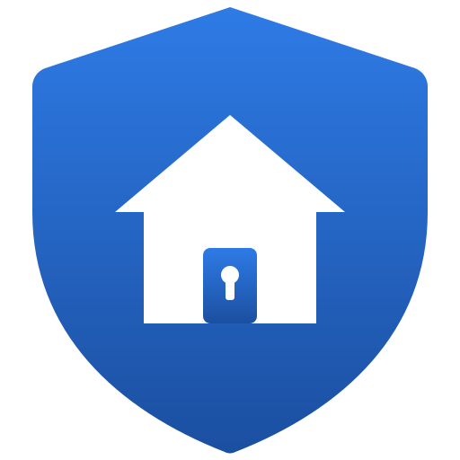
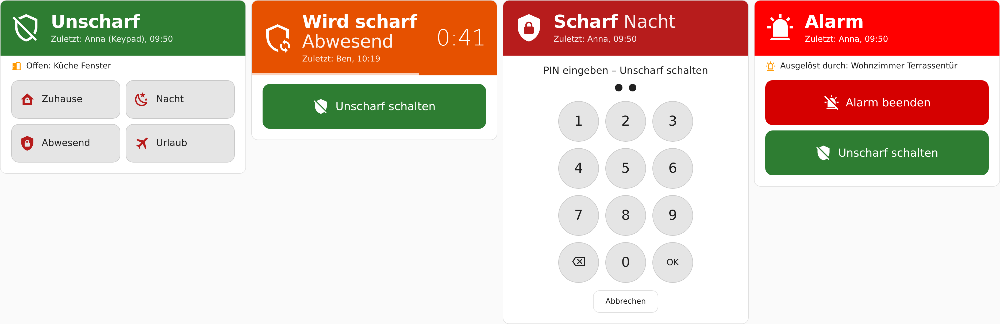
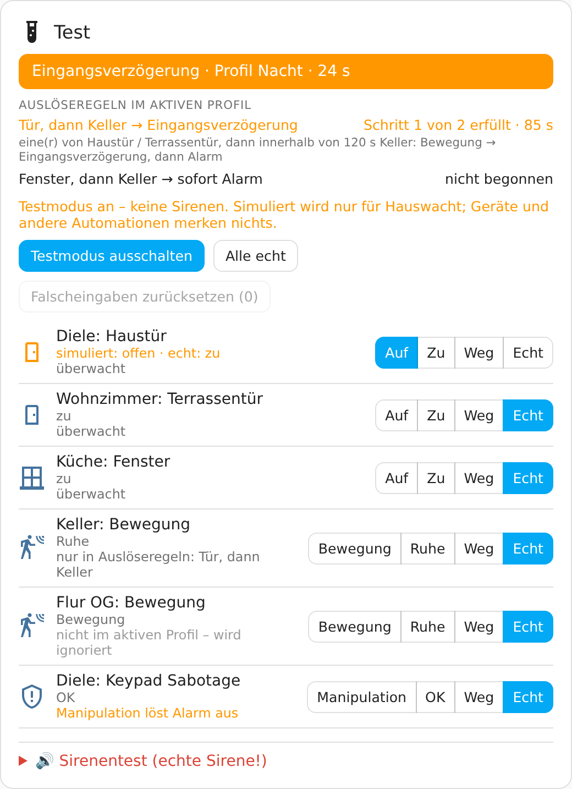
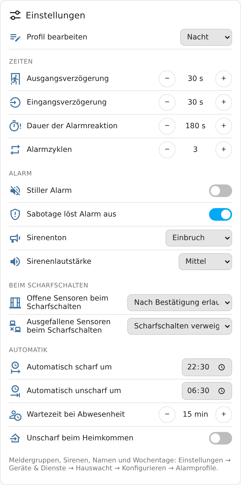

# Hauswacht

**Deutsch** | [English](README.en.md)

**Einbruchmeldeanlage für Home Assistant** – frei definierbare Alarmprofile, Auslöseregeln wie
„Tür, dann Keller“, Benutzer mit PIN und RFID-Karte, Zigbee-Keypads, Sirenen mit Brandsperre
und ein Testmodus, in dem garantiert keine Sirene losgeht. Und weil Hauswacht alles, was es weiß,
als Entitäten, Attribute und Ereignisse bereitstellt, verbindest du es mit **allem, was Home
Assistant kann** – Licht, Kameras, Rollläden, Heizung, Lautsprecher.

> **Status: 0.66.0b8 – Beta.** Im eigenen Haus im Einsatz; Rückmeldungen sind ausdrücklich
> erwünscht. Die echte Sirenenansteuerung ist nach der Installation **gesperrt** und muss bewusst
> freigegeben werden.

**English:** [README in English](README.en.md) · [documentation in English](docs/en/README.md)

  

  
  

## Was Hauswacht kann

- **Einstellungsseite** in der Seitenleiste – die ganze Einrichtung auf einen Blick und alles
  direkt bearbeiten: Matrix „Melder × Profile“, ⓘ-Erklärung an jedem Feld, „?“ zur passenden
  Stelle der Anleitung, Sirenentest (mit Rückfrage) und alle Messungen. Den Überblick gibt
  [So entscheidet Hauswacht](docs/so-entscheidet-hauswacht.md) in Bildern.
- **Alarmprofile statt fester Modi** – „Zuhause“, „Nacht“, „Urlaub“ … beliebig viele, jedes mit
  eigenen Meldergruppen, Verzögerungen, Sirenen und Empfängern. Automatisch scharf nach Uhrzeit
  oder wenn alle weg sind – mit Anwesenheit aus mehreren Signalen je Person (WLAN, Bluetooth,
  Router, Nähe …), je Signal getrennt fürs Ankommen und Weggehen, mit Empfehlung aus euren
  eigenen Messungen („Was wäre wenn“) – und **Bei Rückkehr**: unscharf mit Türbeleg oder nachts nur hereinlassen. Je Wochentag andere Zeiten über einen
  Zeitplan; **Gastmodus**, damit Besuch nicht ausgesperrt wird.
- **Durchgang** – rein oder raus, **ohne unscharf zu schalten**: nachts heimkommen
  mit PIN und irgendeiner Taste, kurz den Müll rausbringen (ebenso) – nur die benutzte Tür ist frei, alles
  andere bleibt scharf. Auch per Push-Knopf „Reinlassen“ oder automatisch, wenn das Handy
  heimkommt.
- **Gekippte Fenster und Erschütterung** – Fenstersensoren und -griffe mit drei Stellungen (zu,
  gekippt, offen): nachts gekippt erlaubt, ganz öffnen löst aus; bei Abwesenheit zählt gekippt wie
  offen. Erschütterungsmelder mit Fehlalarmschutz („2 Stöße in 60 Sekunden“), auch als Zahl.
- **Auslöseregeln** – Alarm erst bei einer Abfolge („Tür, dann Keller innerhalb von 2 Minuten“),
  mit Ausnahmen und Bedingungen; als Formular oder YAML.
- **Alarmkarte ohne PIN-Zwang** – große Karte fürs Tablet: Zustand mit Countdown, ein Knopf je
  Profil, offene Melder mit „Trotzdem scharf“. Wer angemeldet ist, schaltet mit seinen Rechten;
  einen PIN verlangt sie nur, wo es eingestellt ist – z. B. am Wandtablet im Flur.
- **Bereiche** – Haus und Garage unabhängig scharf, mit eigenem Bedienfeld und „Alle Bereiche“.
- **Benutzer und Ausweise** – PIN und beliebig viele RFID-Karten je Person, Rechte je Bereich,
  Gäste mit Gültigkeit, Bedrohungs-PIN mit stillem Notruf, Sperre gegen Durchprobieren.
- **Bedienteile** – Zigbee-Keypads über Zigbee2MQTT mit Rückmeldung am Gerät, **jedes andere
  Keypad** (ZHA, Z-Wave, ESPHome, Node-RED …) über eine Aktion mit Antwort und eine
  Anzeige-Entität, Geräte nur mit MQTT über eine **MQTT-Schnittstelle**, Karten
  direkt am Keypad anlernen, NFC-Aufkleber mit der Home-Assistant-App, RFID-Leser, Taster (nur scharf)
  und Türschlösser (z. B. Nuki: unscharf, wenn ein bekannter Benutzer aufschließt).
  **Aktions-Codes** am Keypad (z. B. 7777 + Haus) starten eigene Automationen oder einen stillen
  Notruf.
- **Benachrichtigungen** – pro Ereignis mit eigenen Empfängern und Texten, wichtige Hinweise
  durchbrechen „Nicht stören“, Knöpfe „Unscharf schalten“ und „Trotzdem scharf“ in der
  Push-Nachricht, Ansagen über Lautsprecher (z. B. Echo).
- **Sirenen mit Verstand** – angesteuert nur nach ihren Fähigkeiten, nie während eines Brandes,
  ein Brandton nur als Experten-Freigabe und nie an Rauchmeldern; Ton je Sirene (z. B. Homematic
  IP Alarmsirene), Sirenen am Schalter per Helfer; Sirenentest einzeln, kurz und leise.
- **Ehrlich bei Störungen** – ausgefallene Melder, Funkstille und Ausfälle von Zigbee2MQTT oder
  MQTT werden sichtbar statt verschwiegen.
- **Testmodus und Testkarte** – alles gefahrlos durchspielen, ohne Sirene, ohne dass andere
  Automationen etwas merken.
- **Anlagenübersicht** – die ganze Konfiguration auf einen Blick, zum Drucken, mit Notfallblatt
  für die Familie und Prüfhinweisen, die Lücken und Vergessenes finden.
- **Beobachten statt raten** – Heimkehr-, Weggehen- und Funkstille-Beobachtung liefern Zahlen,
  bevor man etwas automatisiert – mit Empfehlung je Person, z. B. für die Eingangsverzögerung.

## Offen für alles: Hauswacht als Baustein

Hauswacht schaltet selbst nur Sirenen und verschickt Nachrichten – aber es **stellt alles bereit,
was eine Alarmanlage weiß**, damit du mit eigenen Automationen anschließt, was immer du willst:

| Hauswacht liefert | Zum Beispiel |
|---|---|
| **Bedienfeld** je Bereich mit Zustand und Attributen: `phase` (unscharf, wird scharf, scharf, Eingangsverzögerung, **Alarm**, Alarm vorbei), aktives Profil, auslösender Melder, wer geschaltet hat, Testmodus, Gastmodus | „Wenn Alarm: Licht an“ |
| **Ereignisse** `hauswacht_event` für fast alles, jeweils mit Bereich: scharf, unscharf, Alarm, Sabotage, Melder ausgefallen, falscher PIN, Taster, Aktions-Code, Zeitautomatik … | „Bei Sabotage: kritische Push-Nachricht“ |
| **Entitäten**: offene Melder, Systemstatus, Test- und Gastmodus, Knöpfe, Profil-Einstellungen, Aktions-Code-Ereignis | „Statuslicht rot, solange scharf“ |
| **Aktionen** und **Knöpfe**: scharf schalten mit Profil (auch „trotzdem scharf“), unscharf, Alarm beenden, Gastmodus, Sirenentest, Melder im Testmodus simulieren | „Gastmodus aus dem Kalender“ |

Damit wird Hauswacht zum Kern für vieles, was eine Alarmanlage können soll: bei Alarm **Licht an**
und danach wieder wie vorher, **Kamerabild aufs Handy**, **Rollläden hoch**, Musik aus,
**Heizung runter** bei Abwesenheit, Willkommenslicht beim Heimkommen, Haustür abschließen beim
Scharfschalten – jeweils mit fertiger Vorlage in den **[Beispielen](docs/beispiele.md)**. Welchen
Auslöser du wofür nimmst, zeigt der Spickzettel **[Automationen](docs/automationen.md)**; alle
Entitäten, Attribute und Ereignisse mit ihren Feldern stehen in der **[Referenz](docs/referenz.md)**. Im Testmodus bleibt
das dank des Attributs `test_mode` still.

## Schnellstart

1. **Repository einbinden** und Hauswacht herunterladen, danach Home Assistant neu starten:
   - **Marketplace** (ab Home Assistant 2026.11): [direkt öffnen](https://my.home-assistant.io/redirect/marketplace_repository/?owner=schlusenbaum&repository=hauswacht&category=integration) oder Einstellungen →
     Marketplace → hinzufügen per Link (*Add from link*) → `https://github.com/schlusenbaum/hauswacht`
   - **HACS** (bis 2026.10): HACS → ⋮ → **Benutzerdefinierte Repositories** → `https://github.com/schlusenbaum/hauswacht`,
     Typ **Integration**

   Hauswacht steht (noch) nicht im Katalog (Aufnahme beantragt), daher der Umweg über den Link –
   [Schritt für Schritt](docs/installation.md#installation).
2. Hauswacht einrichten:

   

3. Auf der **Einstellungsseite** (Seitenleiste „Hauswacht“): Meldergruppe und Profil anlegen,
   das Handy als Empfänger eintragen – [in fünf Schritten](docs/installation.md#in-fünf-schritten-zur-ersten-scharfschaltung).
4. Karte **„Hauswacht Test“** aufs Dashboard, Testmodus an, durchspielen.
5. Testmodus aus – fertig. Sirenen erst freigeben, wenn alles passt.

Ausführlich: [Installation und erste Schritte](docs/installation.md).

## Dokumentation

| | |
|---|---|
| [So entscheidet Hauswacht](docs/so-entscheidet-hauswacht.md) | Der Überblick in Bildern: Tür auf, Automatik, Heimkommen, zuhause oder weg |
| [Installation und erste Schritte](docs/installation.md) | Installation, Einstellungsseite, die ersten fünf Schritte |
| [Melder und Meldergruppen](docs/melder.md) | Welche Sensoren, Typen, immer aktiv, Funkstille |
| [Alarmprofile und Bereiche](docs/profile.md) | Profile, Automatik, Scharf durch Türschließen, Bereiche |
| [Auslöseregeln](docs/ausloeseregeln.md) | Abfolgen, Ausnahmen, Bedingungen, YAML |
| [Bedienung und Dashboard](docs/dashboard.md) | Scharf/unscharf, Alarmkarte, Alarm beenden, Karten |
| [Benutzer, PINs und Sperre](docs/benutzer.md) | Benutzer, Rechte, PIN-Regeln, Bedrohungs-PIN |
| [Bedienteile](docs/bedienteile.md) | Keypads, Karten anlernen, NFC, RFID-Leser, Fingerabdruck, Taster, Türschlösser |
| [Sirenen](docs/sirenen.md) | Kompatibilität, Freigabe, Ton je Sirene, Sirene aus Schalter, Sirenentest, „Warum hat sie nicht geklingelt?“, Brandschutz |
| [Benachrichtigungen](docs/benachrichtigungen.md) | Ereignisse, eigene Texte, Sprachausgabe |
| [Anlagenübersicht](docs/uebersicht.md) | Übersicht, Drucken, Notfallblatt, Prüfhinweise |
| [Automationen: was nehme ich wofür?](docs/automationen.md) | Spickzettel: der richtige Auslöser für jeden Anlass |
| [Beispiele](docs/beispiele.md) | Mit anderen Geräten verbinden: Licht, Kamera, Rollläden, Statuslicht, Heizung … |
| [Testmodus](docs/testmodus.md) · [Beobachtungen](docs/beobachtung.md) · [Referenz](docs/referenz.md) · [Fehlersuche](docs/fehlersuche.md) | |

Alles auf einen Blick: [docs/](docs/README.md). Die Anleitung gibt es auch
[auf Englisch](docs/en/README.md).

## Voraussetzungen

- Home Assistant **2026.10** oder neuer
- Melder mit offen/zu (Tür-, Fenster-, Bewegungsmelder …) – herstellerunabhängig
- Optional: Sirenen (`siren`, oder Schalter über einen Helfer), Home-Assistant-App, Zigbee2MQTT für Keypads
- Keine Cloud, keine weiteren Integrationen nötig

## Sicherheit

- **Brandalarm hat immer Vorrang:** Solange ein Rauchmelder Brand meldet oder sein Zustand unklar
  ist, schaltet Hauswacht keine Sirene ein und keine aus.
- **Testmodus sperrt Sirenen technisch**, nicht nur in der Anzeige. Die Sirenenfreigabe ist nach
  der Installation aus.
- **Nach einem Neustart wie vorher** – scharf bleibt scharf (einstellbar: immer scharf oder
  immer unscharf); ein früherer Alarm wird standardmäßig nicht fortgesetzt (einstellbar), sonst gehen Sirenen dadurch nie an – und
  eigene Sirenen, die beim Neustart noch liefen, schaltet Hauswacht danach aus.
- **Hauswacht schaltet keine Geräte** außer Sirenen (auch als Sirene eingetragene Schalter) und
  der Anzeige eingerichteter Keypads – ein Test stellt das sicher. Türschlösser liest
  Hauswacht nur mit, es schaltet sie nie.
- **PINs nicht im Klartext im Verlauf:** Die Entität, in der Zigbee2MQTT den am Keypad getippten
  Code ablegt, deaktiviert Hauswacht automatisch.

Die verbindlichen Regeln: [Sicherheitsregeln](docs/entwicklung/safety.md).

> **Hinweis:** Hauswacht ist ein Hobbyprojekt und **kein zertifiziertes Sicherheitssystem**
> (keine VdS- oder EN-50131-Zertifizierung). Es ersetzt weder eine professionelle
> Einbruchmeldeanlage noch geprüfte Rauchwarnmelder.

**Grenzen, ehrlich gesagt:**

- Hauswacht läuft **nur, solange Home Assistant läuft** – ohne Strom, Netzwerk oder Funk keine
  Alarmierung. Eine USV für Home Assistant, Router und Funk-Gateway ist sinnvoll; Sirenen mit
  eigener Batterie heulen weiter, wenn sie schon laufen.
- **Keine Notrufleitstelle:** Hauswacht benachrichtigt dich und deine Empfänger – einen
  Wachdienst ruft es nicht von selbst (über eigene Automationen, z. B. Telefonie-Dienste, aber
  möglich).
- **Funkstörung** erkennt Hauswacht nur indirekt – über Funkstille und ausgefallene Melder.

## Wie Hauswacht entstanden ist

Hauswacht ist mit **viel Hilfe von KI** entstanden: Große Teile des Codes, der Tests und der
Dokumentation hat **Claude** (Anthropic) geschrieben. Die Ideen, Konzepte, Sicherheitsregeln und
Entscheidungen stammen von mir.

Getestet wird auf zwei Wegen: **im eigenen Haus mit echter Hardware** – Tür- und
Fensterkontakten, Bewegungs- und Präsenzmeldern, Zigbee-Keypad und Sirenen – und zusätzlich mit
**automatischen Tests**, die jede Änderung vor dem Zusammenführen bestehen muss. Die
automatischen Tests spielen auch Fälle durch, die man im Haus nicht ausprobieren möchte, etwa
einen Alarm, während ein Rauchmelder Feuer meldet.

Andere Häuser haben andere Geräte – deshalb sind Rückmeldungen aus anderen Installationen
besonders wertvoll.

## Mitmachen

Fehler und Wünsche gern als [Issue](https://github.com/schlusenbaum/hauswacht/issues) –
Rückmeldungen zu weiteren Sirenen- und Keypad-Modellen sind besonders willkommen. Wer am Code
mitarbeiten möchte: [Entwicklung](docs/README.md#für-entwickler) und [Tests](docs/entwicklung/testing.md).

## Unterstützen

Wenn dir Hauswacht gefällt, freue ich mich über einen Kaffee:

## Lizenz

[MIT](LICENSE)
