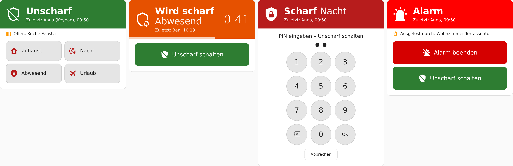
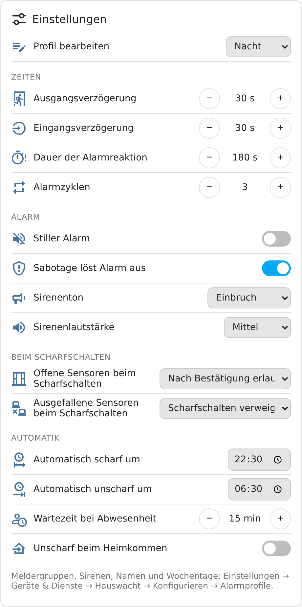

# Bedienung und Dashboard

## Scharf und unscharf schalten

| Weg | Scharf | Unscharf |
|---|---|---|
| **[Karte „Hauswacht Alarm“](#karte-hauswacht-alarm)** | ein Knopf je Profil | „Unscharf schalten“ – ohne PIN für zugeordnete Konten, siehe unten |
| **Bedienfeld** (`alarm_control_panel.hauswacht`, z. B. als Kachel oder Alarm-Karte von Home Assistant) | Knöpfe der Profile, denen ein Knopf zugeordnet ist | „Unscharf“ – mit PIN, sobald irgendein PIN existiert |
| **Auswahlliste + Knopf** (`select.hauswacht_profil`, `button.hauswacht_scharf_schalten`) | jedes Profil, auch ohne Knopf | – |
| **Knopf „Unscharf schalten“** (`button.hauswacht_unscharf_schalten`) | – | sofort, ohne PIN-Abfrage (siehe unten) |
| **Push-Nachricht** | „Jetzt scharf“ (Erinnerung), „Trotzdem scharf“ / „Erneut versuchen“ | Knopf „Unscharf schalten“ bzw. „Alarm beenden“, siehe [Benachrichtigungen](benachrichtigungen.md#push-knopf-unscharf-schalten) |
| **Bedienteile** | Keypad-Taste + PIN/Karte, NFC-Aufkleber, RFID-Leser | ebenso, siehe [Bedienteile](bedienteile.md) |
| **Automatik** | Uhrzeit, alle weg | Uhrzeit, Heimkehr – siehe [Automatik](profile.md#automatik) |
| **Aktion** | `hauswacht.arm` mit Profilnamen | `alarm_control_panel.alarm_disarm` |
| **Sprachassistent** | über das Bedienfeld | über das Bedienfeld, nur mit PIN freigeben |

Beim Scharfschalten prüft Hauswacht offene und ausgefallene Melder nach den Regeln des Profils.
Wird abgelehnt, nennt die Meldung die Melder; mit einer Push-Nachricht kommen die Knöpfe
„Trotzdem scharf“ und „Erneut versuchen“.

### Trotzdem scharf schalten

Erlaubt ein Profil offene oder ausgefallene Melder nur „nach Bestätigung“, verweigert das normale
Bedienfeld das Scharfschalten. Bestätigen geht mit dem Knopf **„Trotzdem scharf schalten“**
(`button.hauswacht_trotzdem_scharf_schalten`, für das gewählte Profil) oder der Aktion:

```yaml
action: hauswacht.arm
target:
  entity_id: alarm_control_panel.hauswacht
data:
  profile: Nacht
  confirm: true
```

Offene Melder werden dabei **überbrückt**, also bis zum Unscharfschalten nicht überwacht. Steht
das Profil auf „verweigern“, lehnt Hauswacht auch die Bestätigung ab.

## Alarm beenden

**„Unscharf schalten“ während eines Alarms beendet nur den Alarm** – egal ob über Karte,
Bedienfeld, Push-Nachricht oder Automation:

- Sirenen aus (die Brandsperre gilt weiter), Anzeige wieder „Scharf“ mit demselben Profil.
- Was in diesem Moment offen ist (z. B. die Tür, durch die jemand kam), wird **überbrückt, bis es
  wieder geschlossen ist**, und danach wieder überwacht. Alle anderen Melder bleiben scharf.
- Meldung „Alarm beendet … bleibt scharf. Bis zum Schließen nicht überwacht: …“.
- **Erst ein zweites „Unscharf schalten“ schaltet wirklich unscharf.**
- Ist ein PIN eingestellt, wird er auch zum Beenden abgefragt.

Zwei Knöpfe für Dashboards:

| Knopf | Wirkung |
|---|---|
| **Unscharf schalten** (`button.hauswacht_unscharf_schalten`) | Sofort unscharf – auch während eines Alarms, ohne Zwischenschritt |
| **Alarm beenden** (`button.hauswacht_alarm_beenden`) | Nur während eines Alarms: Alarm aus, Profil bleibt scharf |

Knöpfe können keinen PIN abfragen. Sobald ein PIN existiert, sind sie deshalb **nicht
verfügbar** – außer unter [PIN-Regeln](benutzer.md#pin-regeln) ist „Dashboard-Knöpfe trotz PIN
erlauben“ (alle Knöpfe) bzw. „Alarm ohne PIN beenden“ (nur „Alarm beenden“) an.

> Abwägung: Wer ein entsperrtes Dashboard in der Hand hat, kann dann ohne PIN bedienen. An die
> Knöpfe kommen aber nur angemeldete Home-Assistant-Benutzer, und nach „Alarm beenden“ bleibt
> die Anlage scharf – jeder weitere Melder löst sofort wieder aus.

## Beispiel-Dashboard „Alarmanlage“

[`examples/dashboard/hauswacht-dashboard.yaml`](../examples/dashboard/hauswacht-dashboard.yaml)
ist ein fertiges Dashboard mit zwei Ansichten:

| Ansicht | Inhalt |
|---|---|
| **Alarm** | Karte „Hauswacht Alarm“, Systemstatus, Testmodus (nur Anzeige), Türen und Fenster mit Badge „offen“, Bewegung, Rauchmelder (nur Anzeige), Keypad-Batterie und -Sabotage, letzter Sirenentest, Verlauf der letzten drei Tage |
| **Verwaltung** | Anlagenübersicht, Profil-Einstellungen, Testkarte |

**Einfügen:** Einstellungen → Dashboards → **Dashboard hinzufügen** → „Neues Dashboard von Grund
auf“ → öffnen → Stift → ⋮ → **Raw-Konfigurationseditor** → Inhalt der Datei einfügen. Danach die
Beispiel-Melder (`binary_sensor.haustuer` …) durch die eigenen ersetzen.

Sirenen stehen bewusst nicht als Kachel im Dashboard – ein Tippen würde sie einschalten.

## Beispielkarte

[`examples/dashboard/hauswacht-karte.yaml`](../examples/dashboard/hauswacht-karte.yaml) nutzt nur
Standardkarten von Home Assistant (ab 2026.5) und funktioniert in jeder Ansichtsart.

**Einfügen:** Dashboard bearbeiten → Karte hinzufügen → ganz unten **Manuell** → Inhalt der
Datei einfügen → Speichern. Die Entitäts-IDs gelten für eine deutschsprachige Instanz; die
englischen stehen oben in der Datei.

| Teil | Wann sichtbar | Zweck |
|---|---|---|
| Kachel „Hauswacht“ | immer | Zustand mit Symbol des aktiven Profils |
| „Profil“ und „Scharf schalten“ | nur unscharf | Profil wählen und scharf schalten |
| „Offen: …“ und „Trotzdem scharf“ | nur unscharf **und** Melder offen | Offene Melder mit Raum; gewähltes Profil mit Bestätigung scharf schalten |
| „Unscharf schalten“ | scharf, Verzögerung oder Alarm | während eines Alarms beendet er nur den Alarm |
| Kachel „Hauswacht-System“ | nur wenn der Systemstatus nicht OK ist | Hinweis auf ausgefallene Melder oder Störungen |

Die Symbolleiste mit allen Bedienfeld-Knöpfen (`alarm-modes`) ist weiter möglich, doppelt aber
die Profilauswahl.

## Karte „Hauswacht Alarm“



Die Karte zum Bedienen – gemacht fürs Tablet an der Wand, passt sich aber auch dem Handy an.
Dashboard bearbeiten → **Karte hinzufügen** → **„Hauswacht Alarm“**. Alles Weitere stellst du
im **visuellen Editor** der Karte ein (siehe [Karte anpassen](#karte-anpassen)).

| Zustand | Anzeige | Knöpfe |
|---|---|---|
| Unscharf | grün; offene Melder darunter | ein Knopf je Alarmprofil (mit dessen Symbol) |
| Wird scharf / Eingangsverzögerung | orange, Restzeit groß und als ablaufender Balken | „Unscharf schalten“ |
| Scharf | rot, mit Profil | „Unscharf schalten“ |
| Alarm | leuchtend rot, blinkt langsam; auslösender Melder | „Alarm beenden“ (bleibt scharf) und „Unscharf schalten“ (ganz aus) |

Dazu: wer zuletzt geschaltet hat und wann, Testmodus, nicht erreichbare Melder und eine laufende
PIN-Sperre. Mit mehreren Bereichen steht jeder Bereich untereinander, dazu „Alle Bereiche
unscharf“.

Die Farben sind fest (grün unscharf, orange Verzögerung, rot scharf, leuchtend rot Alarm) und
folgen nicht den Zustandsfarben von Home Assistant – ändern lassen sie sich in der Karte oder im
Theme.

Verlangt ein Profil bei offenen Meldern eine Bestätigung, nennt die Karte die Melder und bietet
**„Trotzdem scharf schalten“** an – statt nur eine Fehlermeldung zu zeigen.

### Karte anpassen

Im visuellen Editor (Karte bearbeiten) – oder in YAML:

| Einstellung | YAML | Standard |
|---|---|---|
| Titel | `title: Alarm` | keiner |
| Bereich (nur mit mehreren Bereichen) | `bereich: garage` (Kennung oder Name) | alle |
| Größe: groß fürs Tablet oder kompakt (eine Zeile Zustand, kleinere Knöpfe) | `groesse: kompakt` | `gross` |
| **Profilknöpfe:** welche, in welcher Reihenfolge | `profile: [night, away]` | alle, wie angelegt |
| Knöpfe je Zeile | `spalten: 2` (1–4) | automatisch |
| Wer zuletzt geschaltet hat | `zeige_zuletzt: false` | an |
| Offene Melder (unscharf) | `zeige_offen: false` | an |
| Nicht erreichbare Melder | `zeige_nicht_erreichbar: false` | an |
| Hinweis Testmodus | `zeige_testmodus: false` | an |
| Ablaufender Balken bei Verzögerung | `zeige_balken: false` | an |
| Knopf „Alle Bereiche unscharf“ | `zeige_alle_unscharf: false` | an |
| Blinken bei Alarm | `blinken: false` | an |
| **Farben** je Zustand | `farbe_unscharf`, `farbe_verzoegerung`, `farbe_scharf`, `farbe_alarm`, z. B. `"#1565c0"` | grün, orange, rot, leuchtend rot |
| **Rückfrage** vor dem Scharfschalten („Nacht scharf schalten?“) | `rueckfrage_scharf: true` | aus |
| **Rückfrage** vor dem Unscharfschalten | `rueckfrage_unscharf: true` | aus |

- **Ausgeblendete Profile** lassen sich mit dieser Karte nur nicht schalten – z. B. am
  Flur-Tablet nur „Abwesend“ und „Nacht“, auf dem Handy alle.
- **Rückfragen** schützen vor versehentlichem Tippen (Wandtablet, Hosentasche, Kinder). Wird ein
  PIN verlangt, gibt es keine zusätzliche Frage – der PIN ist schon die Bestätigung.
- **Farben fürs ganze Haus** statt je Karte: im Theme `hauswacht-disarmed-color`,
  `hauswacht-pending-color`, `hauswacht-armed-color`, `hauswacht-alarm-color`. Eine Farbe in der
  Karte hat Vorrang.
- **Bewusst nicht einstellbar:** „Unscharf schalten“ und „Alarm beenden“ lassen sich nicht
  ausblenden, und ob die Karte nach dem PIN fragt, steht nicht in der Karte, sondern in
  Hauswacht ([Ohne PIN-Zwang](#ohne-pin-zwang)) – die Kartenkonfiguration kann jeder ändern, der
  das Dashboard bearbeiten darf.

### Ohne PIN-Zwang

Die Alarm-Karte von Home Assistant verlangt einen PIN von **allen**, sobald irgendein PIN
existiert – etwa für das Keypad. Die Karte „Hauswacht Alarm“ schaltet stattdessen über Hauswacht
selbst, und **der Ausweis ist das angemeldete Home-Assistant-Konto**:

| Angemeldetes Konto | In der Karte |
|---|---|
| einem Hauswacht-Benutzer zugeordnet (Normalfall) | **ohne PIN**, mit den Rechten dieses Benutzers je Bereich; im Logbuch steht sein Name |
| zugeordnet, beim Benutzer „In der Alarmkarte PIN verlangen“ an | mit PIN – z. B. für ein Wandtablet |
| keinem Benutzer zugeordnet | mit PIN, solange unter [PIN-Regeln](benutzer.md#pin-regeln) „Alarmkarte: PIN für Konten ohne Hauswacht-Benutzer“ an ist (Standard) |
| es gibt gar keinen PIN | nie ein PIN |

- Wer einen PIN eingeben muss, bekommt eine große Zifferntastatur (auch die Tastatur des Geräts
  funktioniert). Es gilt dieselbe Prüfung wie am Bedienfeld: [Sperre nach falschen
  Eingaben](benutzer.md#sperre-nach-falschen-eingaben), Bedrohungs-PIN, Rechte des Benutzers
  mit diesem PIN. Scharfschalten fragt nur nach dem PIN, wenn „PIN auch zum Scharfschalten
  verlangen“ an ist; „Alarm beenden“ nicht, wenn „Alarm ohne PIN beenden“ an ist.
- Ein Benutzer ohne ein Recht sieht den Knopf ausgegraut.
- Das Konto braucht außerdem in Home Assistant das Recht, das Bedienfeld zu steuern.
- Keypads, Alexa und das Bedienfeld selbst bleiben wie bisher mit PIN.

> **Wandtablet:** Ein dauerhaft angemeldetes Tablet im Flur kann jeder bedienen, der davorsteht.
> Am besten bekommt es ein **eigenes Home-Assistant-Konto** (z. B. „Tablet Flur“), das keinem
> Benutzer zugeordnet ist – dann fragt die Karte dort nach dem PIN, auf den Handys der Familie
> nicht.

## Karte „Hauswacht Einstellungen“



Hauswacht bringt die Karte mit; sie wird automatisch geladen (kein Eintrag unter „Ressourcen“).
Dashboard bearbeiten → **Karte hinzufügen** → **„Hauswacht Einstellungen“** – oder in YAML:

```yaml
type: custom:hauswacht-einstellungen-card
title: Einstellungen   # optional, auch im visuellen Editor
```

Die Karte zeigt die [Profil-Einstellungen](#profil-einstellungen-im-dashboard) des gewählten
Profils und findet die Entitäten selbst; umbenannte Entitäten stören nicht. Im scharfen Zustand
sind alle Einstellungen gesperrt.

## Karte „Hauswacht Test“

Zum gefahrlosen Durchspielen im Testmodus, mit Sirenentest und „Falscheingaben zurücksetzen“ –
siehe [Testmodus und Testkarte](testmodus.md#karte-hauswacht-test).

## Karte „Hauswacht Übersicht“

Die ganze Konfiguration mit Prüfhinweisen, zum Drucken und als Notfallblatt – siehe
[Anlagenübersicht](uebersicht.md).

## Profil-Einstellungen im Dashboard

Kleinigkeiten lassen sich ohne den Einstellungsdialog ändern. Die Entitäten stehen am Gerät
„Hauswacht“ unter **Konfiguration**:

1. **Profil bearbeiten** (`select.hauswacht_profil_bearbeiten`): welches Profil die folgenden
   Einstellungen zeigen und ändern.
2. Zahlen: Ausgangs- und Eingangsverzögerung, Dauer der Alarmreaktion, Alarmzyklen, Wartezeit
   bei Abwesenheit.
3. Auswahl: offene bzw. ausgefallene Sensoren beim Scharfschalten, Sirenenton, Lautstärke.
4. Schalter: Stiller Alarm, Sabotage löst Alarm aus, Unscharf beim Heimkommen.
5. Uhrzeiten: Automatisch scharf um / unscharf um.

- Änderungen nur im unscharfen Zustand; scharf sind die Einstellungen „nicht verfügbar“.
- Jede Änderung wird sofort gespeichert und im Logbuch mit Benutzer festgehalten.
- Name, Symbol, Knopf, Meldergruppen, Sirenen, Empfänger, Personen und Wochentage sowie das
  **Entfernen** einer Uhrzeit gehen nur im Einstellungsdialog.
- Tipp: Eine Dashboard-Seite dafür nur für Administratoren sichtbar machen.

## Eigene Karten

Nützliche Entitäten – alle weiteren in der [Referenz](referenz.md):

| Entität | Inhalt |
|---|---|
| `alarm_control_panel.hauswacht` | Zustand; Attribute `profile_name`, `timer_ends_at`, `open_sensors`, `bypassed_sensors` … |
| `binary_sensor.hauswacht_offene_sensoren` | „Offen“, sobald ein Melder einer Meldergruppe offen ist; Attribut `names` (mit Raum) |
| `sensor.hauswacht_systemstatus` | `ok`, `degraded`, `fault` |
| `select.hauswacht_profil` | Gewähltes bzw. aktives Profil |
| `switch.hauswacht_testmodus` | Testmodus |
