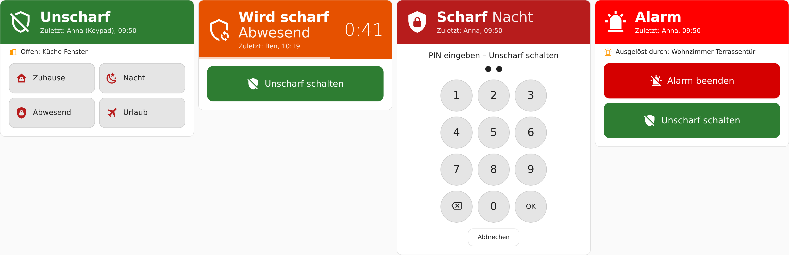
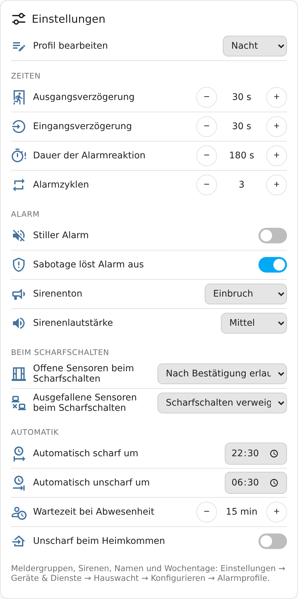

# Operation and dashboard

[Deutsch](../dashboard.md) | **English**

> Entity IDs on this page are those of an English-language Home Assistant. If Home Assistant was
> set to German when Hauswacht was added, they are German (e.g. `select.hauswacht_profil`) – see
> [Reference](reference.md#entities).

## Arming and disarming

| Way | Arm | Disarm |
|---|---|---|
| **[Card "Hauswacht Alarm"](#card-hauswacht-alarm)** | one button per profile | "Disarm" – without PIN for linked accounts, see below |
| **Alarm panel** (`alarm_control_panel.hauswacht`, e.g. as a tile or the alarm card of Home Assistant) | buttons of the profiles that have a button assigned | "Disarm" – with PIN as soon as any PIN exists |
| **Selection list + button** (`select.hauswacht_profile`, `button.hauswacht_arm`) | every profile, also without a button | – |
| **Button "Disarm now"** (`button.hauswacht_disarm_now`) | – | immediately, without PIN prompt (see below) |
| **Push message** | "Arm now" (reminder), "Arm anyway" / "Try again" | button "Disarm" or "End alarm", see [Notifications](notifications.md#push-button-disarm) |
| **Control devices** | keypad key + PIN/card, NFC sticker, RFID reader, button, door lock | likewise (not a button), see [Control devices](control-devices.md) |
| **Automation** | time, everyone away | time, arrival – see [Automation](profiles.md#automation) |
| **Action** | `hauswacht.arm` with profile name | `alarm_control_panel.alarm_disarm` |
| **Voice assistant** | via the alarm panel | via the alarm panel, only enable with a PIN |

When arming, Hauswacht checks open and failed sensors according to the rules of the profile. If
arming is refused, the message names the sensors; a push message comes with the buttons "Arm
anyway" and "Try again".

### Arm anyway

If a profile allows open or failed sensors only "after confirmation", the normal alarm panel
refuses to arm. You confirm with the button **"Arm anyway"** (`button.hauswacht_arm_anyway`, for
the selected profile) or the action:

```yaml
action: hauswacht.arm
target:
  entity_id: alarm_control_panel.hauswacht
data:
  profile: Night
  confirm: true
```

Open sensors are then **bypassed**, i.e. **not monitored until disarming** – even if they are
closed and opened again in between. If the profile is set to "refuse", Hauswacht also refuses
the confirmation.

**Example:** the bathroom window is tilted, you arm "Night" with "Arm anyway". The bathroom window
triggers nothing that night, even if someone closes it and opens it again. All other sensors are
armed normally. Only after disarming is it included normally again.

It is different when **ending an alarm**: there, sensors are only bypassed **until they are
closed** (see below).

The same applies to **failed** sensors you confirmed when arming: while they are missing, nothing
happens. If they come back closed, they are monitored normally again; if they come back **open**,
they trigger (a missed opening is caught up).

## Ending an alarm

**"Disarm" during an alarm only ends the alarm** – no matter whether via card, alarm panel, push
message or automation:

- Sirens off (the fire lock still applies), display "Armed" again with the same profile.
- Whatever is open at this moment (e.g. the door someone came through) is **bypassed until it
  is closed again**, and monitored again after that. All other sensors stay armed.
- Message "Alarm ended … stays armed. Not monitored until closed: …".
- **Only a second "Disarm" really disarms.**
- If a PIN is set, it is also asked for to end the alarm.

Two buttons for dashboards:

| Button | Effect |
|---|---|
| **Disarm now** (`button.hauswacht_disarm_now`) | Disarmed immediately – also during an alarm, without the intermediate step |
| **End alarm** (`button.hauswacht_end_alarm`) | Only during an alarm: alarm off, profile stays armed |

Buttons cannot ask for a PIN. As soon as a PIN exists, they are therefore **unavailable** –
unless "Allow dashboard buttons despite PIN" (all buttons) or "End alarm without PIN" (only "End
alarm") is on under [PIN rules](users.md#pin-rules).

> Trade-off: whoever holds an unlocked dashboard can then operate without a PIN. But only
> logged-in Home Assistant users get to the buttons, and after "End alarm" the system stays
> armed – every further sensor triggers again at once.

## Example dashboard "Alarm system"

[`examples/dashboard/hauswacht-dashboard.yaml`](../../examples/dashboard/hauswacht-dashboard.yaml)
is a ready-made dashboard with two views:

| View | Content |
|---|---|
| **Alarm** | card "Hauswacht Alarm", system status, test mode (display only), doors and windows with an "open" badge, motion, smoke detectors (display only), keypad battery and tamper, last siren test, history of the last three days |
| **Administration** | system overview, profile settings, test card |

**Adding it:** Settings → Dashboards → **Add dashboard** → "New dashboard from scratch" → open
→ pencil → ⋮ → **Raw configuration editor** → paste the content of the file. Then replace the
example sensors (`binary_sensor.haustuer` …) with your own, and the German Hauswacht entity IDs
with the English ones if needed.

Sirens are deliberately not on the dashboard as a tile – one tap would switch them on.

## Example card

[`examples/dashboard/hauswacht-karte.yaml`](../../examples/dashboard/hauswacht-karte.yaml) only
uses standard cards of Home Assistant (from 2026.5) and works in every view type.

**Adding it:** edit dashboard → add card → at the very bottom **Manual** → paste the content of
the file → Save. The entity IDs in the file are for a German-language instance; the English ones
are listed at the top of the file.

| Part | Visible when | Purpose |
|---|---|---|
| Tile "Hauswacht" | always | state with the icon of the active profile |
| "Profile" and "Arm" | only disarmed | choose a profile and arm |
| "Open: …" and "Arm anyway" | only disarmed **and** a sensor is open | open sensors with room; arm the selected profile with confirmation |
| "Disarm now" | armed, delay or alarm | during an alarm it only ends the alarm |
| Tile "Hauswacht system" | only if the system status is not OK | hint at failed sensors or faults |

The toolbar with all alarm panel buttons (`alarm-modes`) is still possible, but duplicates the
profile selection.

## Card "Hauswacht Alarm"



The card for operating – made for a tablet on the wall, but also adapts to a phone. Edit
dashboard → **Add card** → **"Hauswacht Alarm"**. Everything else is set in the card's **visual
editor** (see [Customising the card](#customising-the-card)).

| State | Display | Buttons |
|---|---|---|
| Disarmed | green; open sensors below | one button per alarm profile (with its icon) |
| Arming / entry delay | orange, remaining time large and as a running bar | "Disarm" |
| Armed | red, with profile | "Disarm" |
| Alarm | bright red, blinks slowly; triggering sensor | "End alarm" (stays armed) and "Disarm" (completely off) |

Also shown: who switched last and when, test mode, unreachable sensors and a running PIN
lockout. With several areas, each area is shown below the other, plus "Disarm all areas".

The colours are fixed (green disarmed, orange delay, red armed, bright red alarm) and do not
follow the state colours of Home Assistant – you can change them in the card or in the theme.

If a profile requires confirmation for open sensors, the card names the sensors and offers
**"Arm anyway"** – instead of just showing an error message.

### Customising the card

In the visual editor (edit card) – or in YAML. The YAML keys are German; the visual editor shows
English labels.

| Setting | YAML | Default |
|---|---|---|
| Title | `title: Alarm` | none |
| Area (only with several areas) | `bereich: garage` (ID or name) | all |
| Size: large for the tablet or compact (one line of state, smaller buttons) | `groesse: kompakt` | `gross` (large) |
| **Profile buttons:** which ones, in which order | `profile: [night, away]` | all, as created |
| Buttons per row | `spalten: 2` (1–4) | automatic |
| Who switched last | `zeige_zuletzt: false` | on |
| Open sensors (disarmed) | `zeige_offen: false` | on |
| Unreachable sensors | `zeige_nicht_erreichbar: false` | on |
| Test mode hint | `zeige_testmodus: false` | on |
| Running bar during a delay | `zeige_balken: false` | on |
| Button "Disarm all areas" | `zeige_alle_unscharf: false` | on |
| Button "Guest mode" ([guest mode](profiles.md#guest-mode)) | `zeige_gastmodus: false` | on |
| Blinking on alarm | `blinken: false` | on |
| **Colours** per state | `farbe_unscharf` (disarmed), `farbe_verzoegerung` (delay), `farbe_scharf` (armed), `farbe_alarm`, e.g. `"#1565c0"` | green, orange, red, bright red |
| **Confirmation** before arming ("Arm Night?") | `rueckfrage_scharf: true` | off |
| **Confirmation** before disarming | `rueckfrage_unscharf: true` | off |

- **Hidden profiles** just cannot be switched with this card – e.g. only "Away" and "Night" on the
  hallway tablet, all on the phone.
- **Confirmations** protect against accidental taps (wall tablet, trouser pocket, children). If a
  PIN is required, there is no additional question – the PIN already is the confirmation.
- **Colours for the whole house** instead of per card: in the theme `hauswacht-disarmed-color`,
  `hauswacht-pending-color`, `hauswacht-armed-color`, `hauswacht-alarm-color`. A colour set in the
  card takes precedence.
- **Deliberately not configurable:** "Disarm" and "End alarm" cannot be hidden, and whether the
  card asks for a PIN is not set in the card but in Hauswacht ([No forced PIN](#no-forced-pin)) –
  anyone who may edit the dashboard can change the card configuration.

### One card per area (e.g. granny flat)

Every card can be limited to **one area**. Example: the house has the areas "House" and "Granny
flat", the granny flat has its own dashboard:

```yaml
type: custom:hauswacht-alarm-card
title: Granny flat
bereich: granny_flat   # ID or name of the area
```

The card then only shows and switches this area – with its profile buttons, without "Disarm all
areas"; the "Guest mode" button only applies to this area.

Important: an own dashboard is **no protection**. Whoever has a Home Assistant account can also
open other dashboards. Who may switch what is set in Hauswacht: give the residents of the granny
flat as [users](users.md#rights) rights **only for their area** ("Rights per area"). Then they
can only switch the granny flat on any card. A keypad in the granny flat also gets the area
"Granny flat".

### No forced PIN

The alarm card of Home Assistant asks **everyone** for a PIN as soon as any PIN exists – for
example for the keypad. The card "Hauswacht Alarm" switches through Hauswacht itself instead, and
**the credential is the logged-in Home Assistant account**:

| Logged-in account | In the card |
|---|---|
| linked to a Hauswacht user (normal case) | **without PIN**, with this user's rights per area; the logbook shows the user's name |
| linked, with "Require PIN in the alarm card" on for the user | with PIN – e.g. for a wall tablet |
| not linked to any user | with PIN, as long as "Alarm card: require PIN for Home Assistant accounts without a Hauswacht user" is on under [PIN rules](users.md#pin-rules) (default) |
| there is no PIN at all | never a PIN |

- Whoever has to enter a PIN gets a large number pad (the device keyboard works too). The same
  check as on the alarm panel applies: [lockout after wrong entries](users.md#lockout-after-wrong-entries),
  duress PIN, rights of the user with this PIN. Arming only asks for the PIN if "Require PIN to
  arm" is on; "End alarm" does not if "End alarm without PIN" is on.
- A user without a right sees the button greyed out.
- The account also needs the Home Assistant permission to control the alarm panel.
- Keypads, Alexa and the alarm panel itself still need the PIN as before.

> **Wall tablet:** a permanently logged-in tablet in the hallway can be used by anyone standing
> in front of it. Ideally it gets its **own Home Assistant account** (e.g. "Tablet hallway") that
> is not linked to any user – then the card asks for the PIN there, but not on the family's
> phones.

## Card "Hauswacht Einstellungen" (settings)



Hauswacht brings the card along; it is loaded automatically (no entry under "Resources"). Edit
dashboard → **Add card** → **"Hauswacht Einstellungen"** – or in YAML:

```yaml
type: custom:hauswacht-einstellungen-card
title: Settings   # optional, also in the visual editor
```

The card shows the [profile settings](#profile-settings-on-the-dashboard) of the selected profile
and finds the entities by itself; renamed entities do not matter. While armed, all settings are
locked.

## Card "Hauswacht Test"

For risk-free play-through in test mode, with siren test and "Reset failed attempts" – see
[Test mode and test card](test-mode.md#card-hauswacht-test).

## Card "Hauswacht Übersicht" (overview)

The whole configuration with check hints, for printing and as an emergency sheet – see
[System overview](overview.md).

## Profile settings on the dashboard

Small things can be changed without the settings dialog. The entities are on the device
"Hauswacht" under **Configuration**:

1. **Edit profile** (`select.hauswacht_edit_profile`): which profile the following settings show
   and change.
2. Numbers: exit and entry delay, alarm reaction time, alarm cycles, away delay, door proof
   (location before door).
3. Selections: open or unavailable sensors when arming, siren tone, volume, disarm on arrival
   (Off / As before / With door proof).
4. Switches: silent alarm, tamper triggers alarm.
5. Times: arm automatically at / disarm automatically at.

- Changes only while disarmed; while armed, the settings are "unavailable".
- Every change is saved immediately and recorded in the logbook with the user.
- Name, icon, button, sensor groups, sirens, recipients, persons and weekdays as well as
  **removing** a time are only possible in the settings dialog.
- Tip: make a dashboard page for this visible to administrators only.

## Your own cards

Useful entities – all others in the [reference](reference.md):

| Entity | Content |
|---|---|
| `alarm_control_panel.hauswacht` | state; attributes `profile_name`, `timer_ends_at`, `open_sensors`, `bypassed_sensors` … |
| `binary_sensor.hauswacht_open_sensors_in_sensor_groups` | "Open" as soon as a sensor of a sensor group is open; attribute `names` (with room) |
| `sensor.hauswacht_system_status` | `ok`, `degraded`, `fault` |
| `select.hauswacht_profile` | selected or active profile |
| `switch.hauswacht_test_mode` | test mode |
