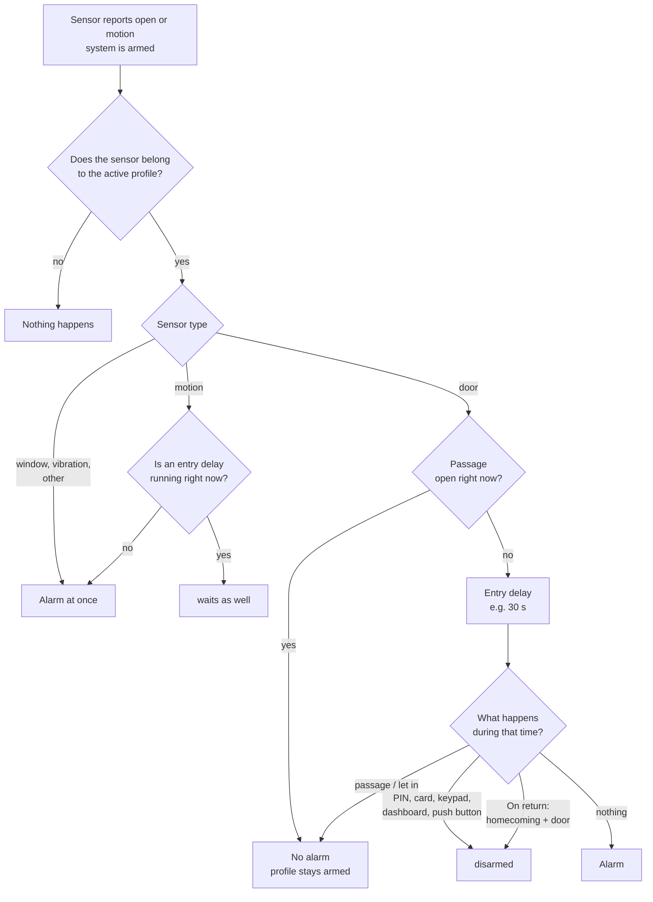
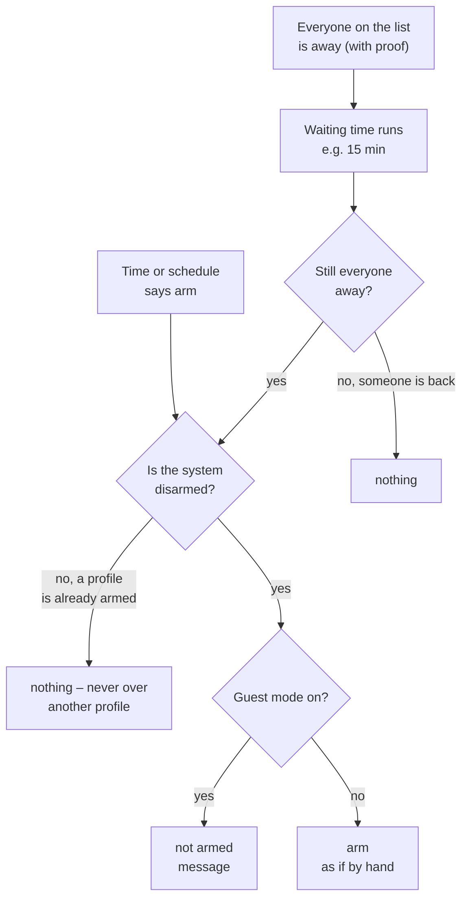
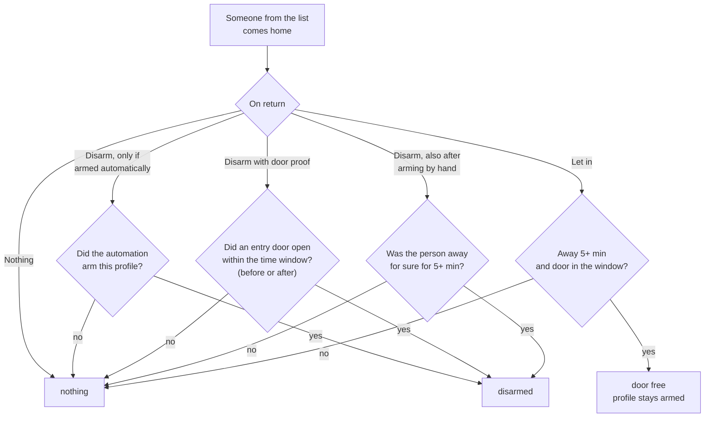
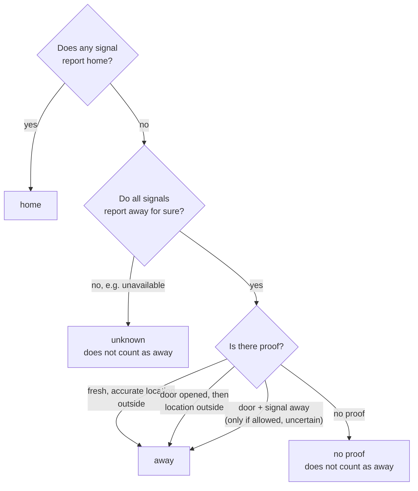

# How Hauswacht decides

[Deutsch](../so-entscheidet-hauswacht.md) | **English**

Hauswacht has many settings, but it only makes a few kinds of decisions. This page shows them as
pictures – with an example and with links to the settings that influence them. If you have lost
track, start here.

| Question | Section |
|---|---|
| What happens when a door opens while the system is armed? | [A door opens](#a-door-opens) |
| When does the automation arm (or disarm)? | [The automation switches](#the-automation-switches) |
| What happens when someone comes home? | [Someone comes home](#someone-comes-home) |
| When does someone count as home, when as away? | [Home or away?](#home-or-away) |
| What does Hauswacht never do on its own? | [What Hauswacht never does on its own](#what-hauswacht-never-does-on-its-own) |
| Where do I set this? | [Where do I set what?](#where-do-i-set-what) |

You can try everything here safely in [test mode](test-mode.md) – sensors and
[presence](test-mode.md#testing-presence) can be simulated there, sirens stay locked.

---

## A door opens

The system is armed, a sensor reports "open" or "motion":

How to read it:

- **Which sensors count** is set by the profile: its sensor groups, without the excluded
  sensors, plus its [trigger rules](trigger-rules.md). A sensor that is only part of a trigger
  rule only triggers when the whole sequence happens ("door, then basement").
- **The type** decides whether the alarm comes at once or the entry delay runs first
  ([types](sensors.md#types)). Motion in the hallway while someone walks to the keypad therefore
  does not trigger an alarm.
- **The entry delay** is set per profile. If someone from the "On return" list approached
  before, it can be longer – see
  [approach](profiles.md#approach-extends-the-entry-delay).
- **Disarming** during that time works with everything that is allowed to: PIN, card, keypad,
  the alarm card or the [push button](notifications.md) – and "On return" with door proof (next
  section).
- **Passage** means: in or out without disarming – see [passage](passage.md).

**Example:** "Night" is armed. Petra comes home at 11 pm, the front door opens → 30 s entry
delay. Her phone reports "home" after 12 s, the profile is set to "disarm with door proof" →
disarmed, no alarm. A burglar through the same door → nobody comes home, nobody types a PIN →
alarm after 30 s. A burglar through the basement window → type window → alarm at once.

What happens during the alarm itself (sirens, messages, how long) is described under
[sirens](sirens.md) and [notifications](notifications.md).

---

## The automation switches

A profile can arm itself – by time, by [schedule](profiles.md#different-times-per-weekday-schedule)
or when **everyone is away** ([automation](profiles.md#automation)):

- **"As if by hand"** means: the same rules apply as when pressing the button – exit delay, open
  or unavailable sensors according to the profile's setting, the message when arming (with the
  reason, e.g. "everyone away"). Only an "arm anyway" confirmation never happens with the
  automation: if a sensor is open that would need it, the system stays disarmed and you get a
  message.
- **"Everyone away"** only counts people who are away **with proof** – see
  [Home or away?](#home-or-away). A sleeping phone does not make anyone absent.
- **Automatic disarming by time or schedule** exists too – only for the profile that is armed
  right now (even if it was armed by hand), and never during an entry delay or an alarm.
- **Guest mode:** as long as it is on, the automation does not arm
  ([guest mode](profiles.md#guest-mode)).

**Example:** "Away" arms when Christian and Petra are away, waiting time 15 minutes. Both leave
at 8:00, Petra's phone reports a location in town at 8:04 → from now on both are away for sure,
the waiting time runs → armed at 8:19. If Christian comes back at 8:10 because he forgot
something, the waiting time stops.

What the automation is doing right now ("arms when everyone is away. Not away yet: Niklas") is
shown on the [test card](test-mode.md#testing-presence) and on the settings page under System →
Presence.

---

## Someone comes home

"On return" sets **per profile** what happens when someone from **its own list of people** comes
home ([On return](profiles.md#on-return)). "Coming home" means: the person was away **with
proof** and now counts as home again.

| Setting | When it makes sense | What to keep in mind |
|---|---|---|
| **Nothing** | The profile should never disarm on its own | – |
| **Disarm, only if armed automatically** | "Away" was armed by "everyone away" – whoever comes home first disarms | Only works while the profile is armed – no longer during the entry delay. The phone has to report "home" before the door opens |
| **Disarm with door proof** | The safe way: phone **and** door have to match | The [time window](profiles.md#what-the-time-window-means) (default 5 min) works in both directions. Also works during the entry delay |
| **Disarm, also after arming by hand** | Also after arming by hand, without a door | With a warning: a phone that reports "home" after a pause disarms – even if nobody is at the door |
| **Let in (passage)** | Coming home at night, "Night" should stay armed | Does not disarm, only opens the door ([passage](passage.md)) |

**Example:** "Night" is set to "Disarm with door proof". Niklas comes home at 1 am. His iPhone joins the
Wi-Fi at 1:02, the front door opens at 1:03 → both within the time window → disarmed. If his
iPhone only reports once he is inside (door at 1:03, Wi-Fi at 1:03:40), it works just the same –
as long as it happens within the entry delay. How long this takes for you is measured by the
[homecoming observation](observations.md#recommendation-for-disarm-with-door-proof).

**Approach:** if the direction (integration "Proximity") reports "approaching" before, the entry
delay can be longer for "with door proof" and "let in". The approach itself never disarms – it
only gives the phone more time ([approach](profiles.md#approach-extends-the-entry-delay)).

---

## Home or away?

All three decisions above ask whether someone is home or away. Hauswacht looks at **all
signals** of the person for this: the person in Home Assistant and the additional signals you
entered under System → Presence (Wi-Fi, ping, Bluetooth, router, direction …).

- **Home** always wins: a single signal reporting "home" is enough.
- **Away** needs **proof**, otherwise a sleeping phone could make someone absent
  (["away" only with proof](profiles.md#away-only-with-proof)). Proof means locations outside the
  zone "Home" (Companion app, iCloud3, GPS trackers). Wi-Fi, ping and Bluetooth have no
  coordinates – they only confirm.
- **Door + signal** is meant for people without a location and is allowed per person: an entry
  door opened, then all signals reported "away". This is less certain – that is why it comes
  with a warning.
- **Direction** only counts as "arrived" (home) or "moving away" (away). "Approaching" does not
  make anyone home.

**Example:** Niklas only has ping. Without a location there is never safe proof for him. If
"door + signal" is allowed for him, he counts as away when a door opened and his ping then
reports "away". Otherwise he stays "not away" for Hauswacht, and "everyone away" waits for him.

**From 0.66.0b1** you can set per person which signals count for **arriving** and which for
**leaving**, and whether **one is enough (after a door)** for leaving: an entry door was open,
afterwards one of the leaving signals reports "away" – that is then enough even without a
location. If you set nothing, everything works as described above. More under
[Arriving and leaving per signal](profiles.md#arriving-and-leaving-per-signal).

Why someone is home or away right now is shown on the [test card](test-mode.md#testing-presence)
and on the settings page (System → Presence) – with the reason, e.g. "Proof: door + location
outside".

---

## What Hauswacht never does on its own

No matter how the settings are:

- **A running alarm is never ended automatically** – neither by "On return" nor by time. That only
  works with PIN, card, keypad or the button "End alarm".
- **The automation never switches over another profile.** If "Night" is armed, "Away" is not
  armed automatically – even if everyone is away.
- **In guest mode the automation never arms.** Arming by hand still works, and "On return" works
  as usual.
- **The approach never disarms** and never lets anyone in.
- **Without proof nobody is away.** An unclear state always counts as "not away".
- **In test mode no siren sounds.**
- **Hauswacht does not switch other devices** – except released sirens and the displays of
  configured keypads. Hauswacht does not touch smoke detectors and fire alarms.

---

## Where do I set what?

Everything on the [settings page](settings-page.md) (page "Hauswacht" in the sidebar):

| What | Where | More |
|---|---|---|
| Which sensors count in a profile | Profile → sensor groups, excluded sensors, trigger rules | [Alarm profiles](profiles.md#alarm-profiles) |
| Type of a sensor (at once or delay) | Sensors | [Types](sensors.md#types) |
| Entry and exit delay | Profile | [Alarm profiles](profiles.md#alarm-profiles) |
| Arm automatically: time, schedule, everyone away | Profile → automation | [Automation](profiles.md#automation) |
| On return, time window, approach | Profile → On return | [On return](profiles.md#on-return) |
| Signals per person, proof for "away" | System → Presence | [How Hauswacht knows who is home](profiles.md#how-hauswacht-knows-who-is-home) |
| Which signals count for arriving and leaving, "one is enough (after a door)", recommendation | System → Presence → "Which signals count?" | [Arriving and leaving per signal](profiles.md#arriving-and-leaving-per-signal) |
| Passage | Profile, control devices | [Passage](passage.md) |
| Guest mode | Switch "Guest mode" | [Guest mode](profiles.md#guest-mode) |
| What happens on alarm | Profile → sirens, notify | [Sirens](sirens.md), [Notifications](notifications.md) |
| Measurements for good settings | System → Presence → Measurements | [Observations](observations.md) |
