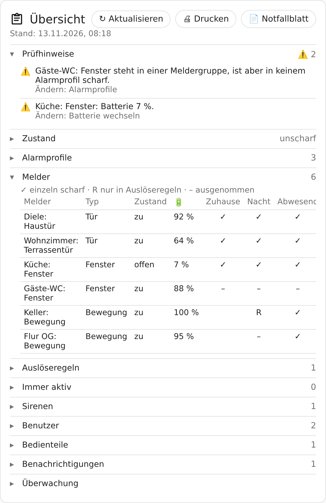

# System overview, check hints and diagnostics

[Deutsch](../uebersicht.md) | **English**

## Card "Hauswacht Übersicht" (overview)



The whole configuration of the system at a glance – **who, what, when, why**. Administrators only;
other users see the hint "The overview is for administrators only".

Edit dashboard → **Add card** → **"Hauswacht Übersicht"** – or in YAML:

```yaml
type: custom:hauswacht-uebersicht-card
title: Overview   # optional
```

**On screen**, a short version with expandable sections:

| Section | Content |
|---|---|
| **Check hints** | at the very top, see [below](#check-hints) – already expanded if there are warnings |
| State | per area, [guest mode](profiles.md#guest-mode) (off / until a time / until switched off), test mode, sirens enabled, system status, wrong entries |
| Alarm profiles | per profile: button, sensor groups, exceptions, trigger rules, times, behaviour, sirens, recipients, automation, arm by closing the door |
| Sensors | table **sensor × profile**: ✓ armed individually, R only in trigger rules, – excluded; plus type, state, battery |
| Trigger rules | in plain language, with the profiles that use them |
| Always active, sirens | sensors and sirens; what each siren can do, last test |
| Users | PIN yes/no, cards (shortened), rights per area, validity, [force arm at the keypad](control-devices.md#arm-anyway-at-the-keypad) yes/no; PIN rules |
| Control devices | keypads with key assignment, stickers and readers with action, buttons with press types, door locks with source |
| Action codes | per [action code](control-devices.md#action-codes): name, code + key, action (for "arm" with profile), keypad or "all keypads"; ⚠️ marks a deleted profile or keypad |
| Notifications | recipients per event, announcements, quiet hours |
| Monitoring | radio silence limit with recommendation, radio networks and gateways, learning time, homecoming observation with [download](observations.md) of report and table |

The card loads the data when opened; **Refresh** fetches the latest state.

### Printing

**Print** creates the **full version** as A4 pages (black and white, all sections expanded,
sensor table with last contact) and opens the browser's print dialog – "Save as PDF" works there
too. Only the overview is printed, not the dashboard.

> The printout contains security information, e.g. which windows are not monitored at night.
> This is also stated at the top of the sheet – do not leave it lying around.

### Emergency sheet

**Emergency sheet** prints one page for family and guests, e.g. for the cupboard next to the
keypad: arming and disarming (keypad, app), which profiles exist, how much time remains after the
door is opened, how to arm at the keypad despite an open window (only if a profile allows it and
at least one user has the right), what happens on an alarm, who is notified and what applies in case of fire.
Without technical details and without security details.

### What never appears in the overview

- **PINs** – not even parts or hashes; only "PIN: yes/no".
- **Card numbers** only shortened ("…2880"), with the name in front ("key ring …2880"); disabled cards with ⏸.
- **Code of a silent emergency:** action codes with the action "silent emergency" only appear
  as "hidden" – the printout should not tell anyone which code calls for help unnoticed. The
  other action codes appear in plain text; they are not a secret like a PIN.
- **Duress PIN:** whether someone has one does not show in the overview. Only if it would have no
  effect without recipients is there a check hint – without names.

## Check hints

Hauswacht looks critically at its own configuration and reports gaps, forgotten items and
contradictions. Every hint says **where** to change it.

| Hint | Kind |
|---|---|
| profile without siren **and** without recipients – an alarm reaches nobody | ⚠️ important |
| duress PIN set up, but no recipients | ⚠️ important |
| action code "silent emergency", but no recipient for the event "Alarm" – the emergency reaches nobody | ⚠️ important |
| siren knows no burglar tone – would stay silent ([Tone per siren](sirens.md#tone-per-siren)) | ⚠️ important |
| sensor unavailable **for more than 24 hours** | ⚠️ important |
| test mode on | ⚠️ |
| profile without sensor groups and without trigger rules | ⚠️ |
| sensor in a sensor group, but armed in no profile (not in a rule either) | ⚠️ |
| sensor unavailable (shorter than 24 h) | ⚠️ |
| battery below 10 % | ⚠️ |
| siren not heard in the last test | ⚠️ |
| fire tone released for burglary ([experts](sirens.md#fire-tone-as-expert-release)) | ⚠️ |
| fault of a monitored radio network/gateway | ⚠️ |
| action code "arm" whose alarm profile was deleted – the code arms nothing | ⚠️ |
| [Leaving](observations.md#leaving-preparation-for-detect-leaving-without-pin): leaving of a person cannot be detected reliably (long silent pauses or too slow) – with a tip for a better signal | ⚠️ |
| [Assistant](setup-wizard.md#what-is-checked): a setting that **never applies** – e.g. a person without a location in "arm when all away", "disarm only if armed automatically" without automation, door proof without an entry door | ⚠️ |
| profile without siren (notification only) | ℹ️ |
| sirens in profiles, but not enabled yet | ℹ️ |
| siren never tested or last test older than half a year | ℹ️ |
| user without PIN while others have one | ℹ️ |
| guest whose validity has expired | ℹ️ |
| radio silence detection off or tighter than recommended | ℹ️ |
| no radio network/gateway monitored | ℹ️ |
| trigger rule that no profile uses | ℹ️ |
| action code for a keypad that no longer exists | ℹ️ |
| [Leaving](observations.md#leaving-preparation-for-detect-leaving-without-pin): leaving of a person is detected reliably – with the recommended waiting time | ℹ️ |
| guest mode is on – with its end ("until 17 Nov 18:30") or "until switched off"; profile automation and reminders are paused | ℹ️ |

Sensors of type **Technical** and always-active sensors do not count as "unused".

### As a repair in Home Assistant

The **important** hints also appear under **Settings → Repairs** (with a counter in the sidebar) –
so they stand out without opening the overview. Everything else is only in the overview, so the
repairs list does not get cluttered.

- Checked two minutes after startup and hourly after that.
- Once something is fixed, the hint disappears by itself at the next check.
- You can also "ignore" a hint in Home Assistant.

Hauswacht reports batteries only in the overview – for notifications about weak batteries there
are better tools (e.g. Battery Notes).

## Diagnostics file for bug reports

Settings → Devices & services → Hauswacht → ⋮ → **Download diagnostics** provides a file (JSON)
with the settings and the overview. It is not meant for reading but for **attaching to an
[issue](https://github.com/schlusenbaum/hauswacht/issues)**: whoever sees it knows the exact
configuration without asking ten times.

Before creating it, Hauswacht automatically removes: PINs and their hashes, card numbers, the user
list, action codes, recipients, persons, speakers, Wi-Fi names, MQTT topics and device IDs of readers. Sensor
and profile names stay in – please have a quick look before uploading.
