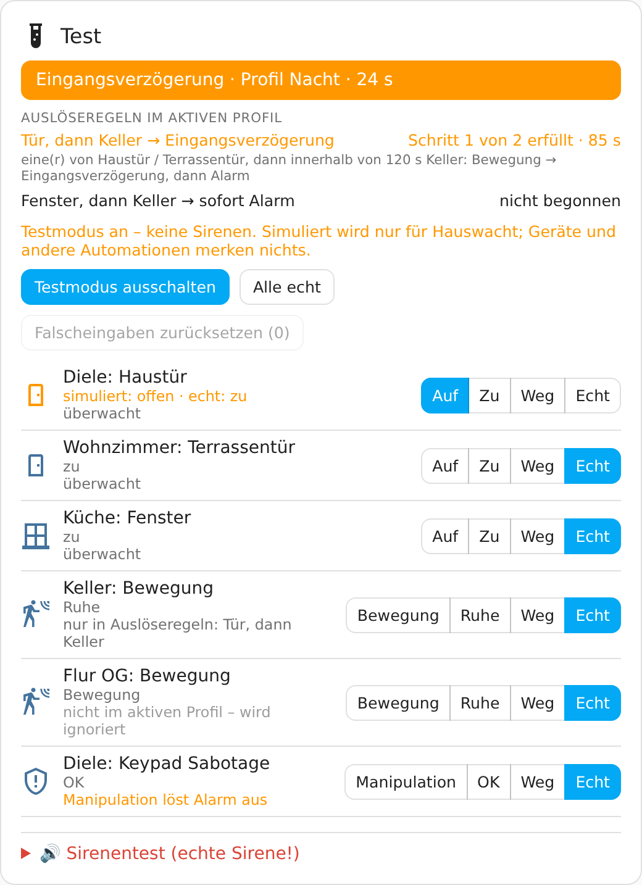

# Test mode and test card

[Deutsch](../testmodus.md) | **English**

In **test mode** everything runs as in an emergency – arming, delays, alarm, notifications – but:

- **Sirens are never controlled**, not even with the hardware enabled. This is enforced
  technically, not just displayed.
- Alarms are marked as test alarms.
- Notifications and announcements only if "Also notify in test mode" is on; the title then starts
  with "[TEST]", announcements with "Test.".
- Test mode can only be switched while all areas are disarmed. It is kept across a restart.

Switch: `switch.hauswacht_test_mode` or at the top of the test card.

## Card "Hauswacht Test"



Edit dashboard → **Add card** → **"Hauswacht Test"** – or in YAML:

```yaml
type: custom:hauswacht-test-card
title: Test   # optional
```

At the top the card shows the state of the system with the profile (with a countdown during the
entry and exit delay), below that the **trigger rules of the active profile** ("not started" or
"step 1 of 2 fulfilled · 85 s") and **all sensors** with room, real state and buttons:

| Kind of sensor | Buttons |
|---|---|
| door, window, opening, garage door | **Open** / **Closed** |
| [sensors with tilt position](sensors.md#sensors-with-tilt-position-tilted) | **Open** / **Tilted** / **Closed** |
| motion, presence, occupancy | **Motion** / **Clear** |
| tamper | **Tamper** / **OK** |
| vibration | **Vibration** / **Calm** (the false alarm protection counts along) |
| all | **Gone** (unavailable), **Real** (back to the real value) |

Below each sensor it says what Hauswacht is currently doing with it:

| Hint | Meaning |
|---|---|
| monitored | triggers in the active profile |
| not in the active profile | is ignored (e.g. basement with the profile "Home") |
| only in trigger rules: … | belongs only to these trigger rules in the active profile |
| bypassed | was open when arming ("Arm anyway"); not monitored until disarming |
| bypassed until closed | was open when an alarm was ended or after a restart; monitored again only after **Closed** |
| always active | reports even when disarmed |
| tamper triggers alarm / message only | depending on the profile; when disarmed always just a message |

At the top of the card:

- **Test mode** on/off.
- **All real** – resets all simulated sensors.
- **Reset failed attempts (N)** – resets the counter of wrong PIN/card entries and a running
  [lockout](users.md#lockout-after-wrong-entries). Administrators only, only clickable if there
  are failed attempts; during a lockout it says "locked".

## How the simulation works

- Simulating is **only possible in test mode**.
- The simulated state applies **only to Hauswacht**: arming, open sensors, entry delay, alarm,
  tampering, failure – all as real. The device and its state in Home Assistant stay unchanged,
  **other automations notice nothing**.
- As long as a sensor is simulated, its real state does not count for Hauswacht (the card still
  shows it). "Real" takes over the real value – if the window is really open and the system is
  armed, this then causes a test alarm.
- **Test mode off = everything real again.** After a restart, simulations are gone too.

The same as actions:

```yaml
action: hauswacht.simulate_state
target:
  entity_id: alarm_control_panel.hauswacht
data:
  sensor: binary_sensor.front_door_contact
  state: "on"        # on · off · unavailable · real
```

`hauswacht.simulate_trigger` (trigger a sensor briefly) and `hauswacht.simulate_reset` (all back)
exist as well.

## Testing presence

The profile automation arms when **everyone is away** and disarms when someone **comes back**
(see [Profiles → Automation](profiles.md#automation)). So you can try this without actually
leaving the house, the test card shows a **"Presence"** block below the sensors.

### What you see (always, even without test mode)

One line per person: **home**, **away** or **unknown** – and why. Examples:

| Display | Meaning |
|---|---|
| Niklas: **home** – home according to: Niklas iPhone Wi-Fi | At least one signal says "home". |
| Finja: **away** – Proof: fresh location outside (14:32) | A fresh, accurate location is outside the home zone. |
| Martin: **away** – Proof: door + signal (uncertain) | The door opened, then the signal reported "away" (only if allowed for him). |
| Niklas: **home** – all signals "away", but no proof | Everything says "away", but there is no proof. For Hauswacht he still counts as **not away**. |
| Finja: **unknown** – unclear: Finja iPhone | A signal currently delivers nothing usable. |

Above that, **for each profile with automation**, what "everyone away" is doing right now:

- **"all away – armed in 4:12"** – everyone is away, the waiting time is running. Afterwards
  the profile is switched on.
- **"waiting for: Niklas, Finja"** – these people do not count as away yet.

You find the same state on the settings page under **System → Presence** ("Who counts as home
right now?"). There it is the state when the page was opened.

### Simulating presence (test mode only)

In test mode each person has these buttons:

| Button | What Hauswacht then assumes |
|---|---|
| **Home** | The person is home. |
| **Away** | The person is away **and** there is proof. Counts for "everyone away". |
| **Away without proof** | All signals say "away", but without proof. Does **not** count as away – this is how you check that Hauswacht does not arm too early. |
| **Approaching** | The person is away and is coming back right now. Use it to test "On return" and the longer entry delay when approaching. |
| **Real** | Simulation for this person off – the real state applies again. |

The active button is highlighted. As with sensors: **the simulation only affects Hauswacht.**
The persons in Home Assistant and all other automations stay unchanged. **Test mode off** or a
**restart** resets everything to "Real".

The waiting time of "everyone away" is **not** shortened – the system behaves exactly as in
real operation. So you do not have to wait, the button **"Skip waiting time"** appears while
it runs: it ends the waiting time at once, as if it had expired.

**Example – arm when everyone is away:**

1. Test mode on.
2. Press **Away** for every person → the top says "all away – armed in …".
3. **Skip waiting time** → the profile is armed (test mode: no siren).
4. Press **Approaching** for one person, then **Open** the front door in the card →
   depending on "On return" the system disarms or the entry delay runs.
5. Test mode off → everything real again.

**Example – no proof:** Set everyone to **Away without proof** → the top still says
"waiting for: …". That is how it should be: without proof there is no automatic arming.

Time-based automations (time of day) cannot be simulated yet.

The same as actions:

```yaml
action: hauswacht.simulate_presence
target:
  entity_id: alarm_control_panel.hauswacht
data:
  person: person.niklas
  state: away        # home · away · away_no_proof · approaching · real
```

```yaml
action: hauswacht.skip_wait
target:
  entity_id: alarm_control_panel.hauswacht
```

## Siren test in the card

At the very bottom, **collapsed**: "🔊 Siren test (real siren!)". Expanded, it shows every siren
with its last test. "Test …" asks first ("Siren will sound for 3 s now. Really start?"), then
"Heard it? Yes/No".

This is **not a simulation**: the real siren sounds (3 s, low) – which is why it is locked in test
mode and for administrators only. Everything else under [Siren test](sirens.md#siren-test).

## A test run

1. Test mode on.
2. Arm the profile "Night" → the exit delay runs out.
3. Front door **Open** → entry delay with countdown.
4. Disarm at the keypad or alarm panel – or wait: test alarm, push with "[TEST]", no siren.
5. **All real**, test mode off.
