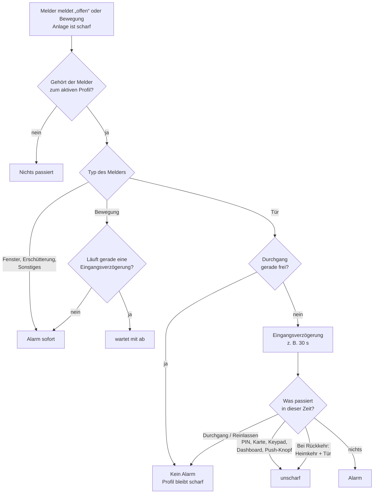
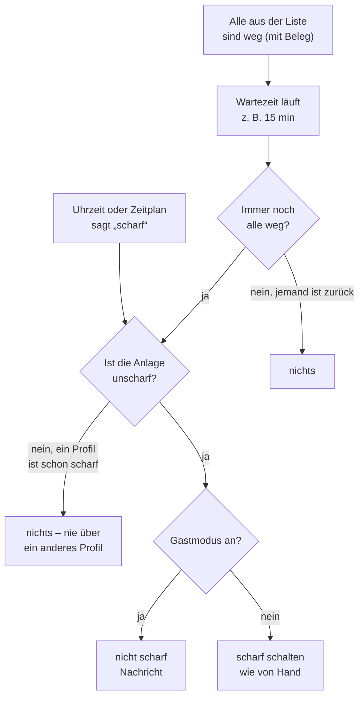
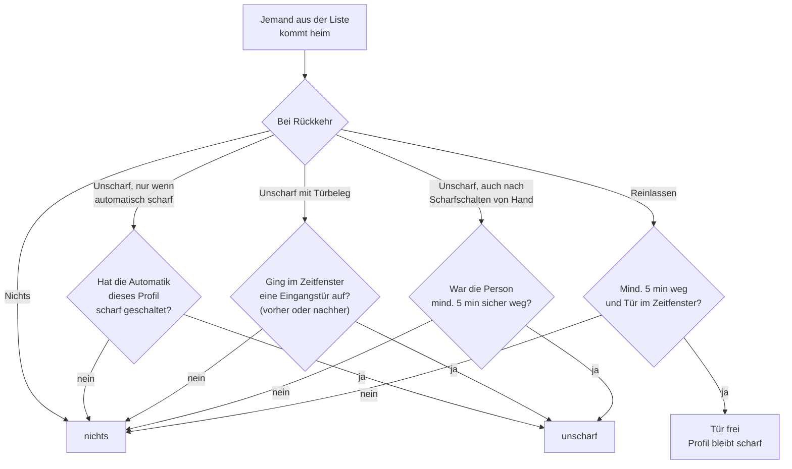
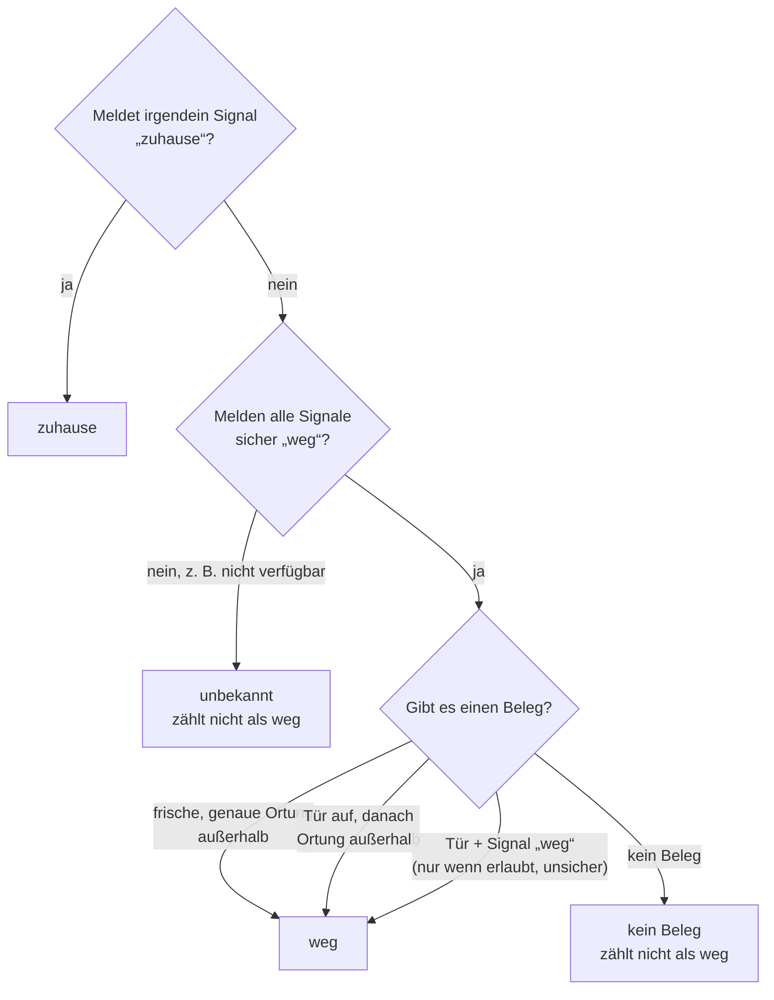

# So entscheidet Hauswacht

**Deutsch** | [English](en/how-hauswacht-decides.md)

Hauswacht hat viele Einstellungen, trifft aber nur wenige Arten von Entscheidungen. Diese Seite
zeigt sie als Bild – mit Beispiel und mit Verweis auf die Einstellungen, die sie beeinflussen.
Wer den Überblick verloren hat, fängt hier an.

| Frage | Abschnitt |
|---|---|
| Was passiert, wenn bei scharfer Anlage eine Tür aufgeht? | [Eine Tür geht auf](#eine-tür-geht-auf) |
| Wann schaltet die Automatik scharf (oder unscharf)? | [Die Automatik schaltet](#die-automatik-schaltet) |
| Was passiert, wenn jemand heimkommt? | [Jemand kommt heim](#jemand-kommt-heim) |
| Wann gilt jemand als zuhause, wann als weg? | [Zuhause oder weg?](#zuhause-oder-weg) |
| Was tut Hauswacht nie von selbst? | [Was Hauswacht nie von selbst tut](#was-hauswacht-nie-von-selbst-tut) |
| Wo stelle ich das ein? | [Wo stelle ich was ein?](#wo-stelle-ich-was-ein) |

Alles hier kannst du gefahrlos im [Testmodus](testmodus.md) ausprobieren – Melder und
[Anwesenheit](testmodus.md#anwesenheit-testen) lassen sich dort simulieren, Sirenen bleiben
gesperrt.

---

## Eine Tür geht auf

Die Anlage ist scharf, ein Melder meldet „offen“ oder „Bewegung“:

So liest du das:

- **Welche Melder zählen**, legt das Profil fest: seine Meldergruppen, ohne die ausgenommenen
  Melder, plus seine [Auslöseregeln](ausloeseregeln.md). Ein Melder, der nur in einer
  Auslöseregel steht, löst erst aus, wenn die ganze Abfolge passiert („Tür, dann Keller“).
- **Der Typ** entscheidet, ob sofort Alarm kommt oder erst die Eingangsverzögerung läuft
  ([Typen](melder.md#typen)). Eine Bewegung im Flur, während jemand gerade zum Keypad läuft,
  löst deshalb keinen Alarm aus.
- **Die Eingangsverzögerung** ist je Profil eingestellt. Hat sich vorher jemand aus der Liste
  „Bei Rückkehr“ genähert, kann sie länger sein – siehe
  [Annäherung](profile.md#annäherung-verlängert-die-eingangsverzögerung).
- **Unscharf** schaltet in dieser Zeit alles, was dazu berechtigt ist: PIN, Karte, Keypad, die
  Alarmkarte oder der [Push-Knopf](benachrichtigungen.md) – und „Bei Rückkehr“ mit Türbeleg
  (nächster Abschnitt).
- **Durchgang** heißt: rein oder raus, ohne unscharf zu schalten – siehe [Durchgang](durchgang.md).

**Beispiel:** „Nacht“ ist scharf. Petra kommt um 23 Uhr heim, die Haustür geht auf → 30 s
Eingangsverzögerung. Ihr Handy meldet nach 12 s „zuhause“, das Profil steht auf „Unscharf mit
Türbeleg“ → unscharf, kein Alarm. Ein Einbrecher durch dieselbe Tür → niemand kommt heim, niemand
tippt einen PIN → nach 30 s Alarm. Ein Einbrecher durchs Kellerfenster → Typ Fenster → sofort
Alarm.

Was beim Alarm selbst passiert (Sirenen, Nachrichten, wie lange), steht unter
[Sirenen](sirenen.md) und [Benachrichtigungen](benachrichtigungen.md).

---

## Die Automatik schaltet

Ein Profil kann sich selbst scharf schalten – nach Uhrzeit, nach
[Zeitplan](profile.md#je-wochentag-andere-zeiten-zeitplan) oder wenn **alle weg** sind
([Automatik](profile.md#automatik)):

- **„Wie von Hand“** heißt: Es gelten dieselben Regeln wie beim Knopfdruck – Ausgangsverzögerung,
  offene oder ausgefallene Melder je nach Einstellung des Profils, die Nachricht beim
  Scharfschalten (mit dem Grund, z. B. „alle weg“). Nur eine Bestätigung „Trotzdem scharf“ gibt
  es bei der Automatik nie: Ist dafür ein Melder offen, bleibt die Anlage unscharf, und du
  bekommst eine Meldung.
- **„Alle weg“** zählt nur, wer **mit Beleg** weg ist – siehe [Zuhause oder weg?](#zuhause-oder-weg).
  Ein schlafendes Handy macht niemanden abwesend.
- **Automatisch unscharf nach Uhrzeit oder Zeitplan** gibt es auch – nur für das Profil, das
  gerade scharf ist (auch wenn es von Hand scharf geschaltet wurde), und nie während einer
  Eingangsverzögerung oder eines Alarms.
- **Gastmodus:** Solange er an ist, schaltet die Automatik nicht scharf
  ([Gastmodus](profile.md#gastmodus)).

**Beispiel:** „Abwesend“ wird scharf, wenn Christian und Petra weg sind, Wartezeit 15 Minuten.
Beide fahren um 8:00 los, Petras Handy meldet um 8:04 eine Ortung in der Stadt → ab jetzt sind
beide sicher weg, die Wartezeit läuft → um 8:19 scharf. Kommt Christian um 8:10 zurück, weil er
etwas vergessen hat, bricht die Wartezeit ab.

Was die Automatik gerade macht („wird scharf, wenn alle weg sind. Noch nicht weg: Niklas“), zeigt
die [Testkarte](testmodus.md#anwesenheit-testen) und die Einstellungsseite unter System →
Anwesenheit.

---

## Jemand kommt heim

„Bei Rückkehr“ legt **je Profil** fest, was passiert, wenn jemand aus **seiner Personenliste**
heimkommt ([Bei Rückkehr](profile.md#bei-rückkehr)). „Heimkommen“ heißt: Die Person war
**mit Beleg** weg und gilt jetzt wieder als zuhause.

| Einstellung | Wann sinnvoll | Worauf achten |
|---|---|---|
| **Nichts** | Das Profil soll nie von selbst unscharf werden | – |
| **Unscharf, nur wenn automatisch scharf** | „Abwesend“ wurde durch „alle weg“ scharf – wer zuerst heimkommt, schaltet ab | Wirkt nur, solange das Profil scharf ist – nicht mehr in der Eingangsverzögerung. Das Handy muss also vor der Tür „zuhause“ melden |
| **Unscharf mit Türbeleg** | Der sichere Weg: Handy **und** Tür müssen zusammenpassen | Das [Zeitfenster](profile.md#was-das-zeitfenster-bedeutet) (Standard 5 min) gilt in beide Richtungen. Wirkt auch während der Eingangsverzögerung |
| **Unscharf, auch nach Scharfschalten von Hand** | Auch nach Scharfschalten von Hand, ohne Tür | Mit Warnhinweis: Ein Handy, das nach Pause „zuhause“ meldet, schaltet ab – auch wenn niemand an der Tür ist |
| **Reinlassen (Durchgang)** | Nachts heimkommen, „Nacht“ soll scharf bleiben | Schaltet nicht unscharf, gibt nur die Tür frei ([Durchgang](durchgang.md#reinlassen-per-handy)) |

**Beispiel:** „Nacht“ steht auf „Unscharf mit Türbeleg“. Niklas kommt um 1 Uhr heim. Sein iPhone meldet
sich um 1:02 im WLAN, um 1:03 geht die Haustür auf → beides im Zeitfenster → unscharf. Meldet
sein iPhone sich erst, als er schon drin ist (Tür um 1:03, WLAN um 1:03:40), klappt es genauso –
solange es innerhalb der Eingangsverzögerung passiert. Wie lange das bei euch dauert, misst die
[Heimkehr-Beobachtung](beobachtung.md#empfehlung-für-unscharf-mit-türbeleg).

**Annäherung:** Meldet die Richtung (Integration „Nähe“) vorher „nähert sich“, kann die
Eingangsverzögerung für „mit Türbeleg“ und „reinlassen“ länger sein. Die Annäherung selbst
schaltet nie unscharf – sie gibt dem Handy nur mehr Zeit
([Annäherung](profile.md#annäherung-verlängert-die-eingangsverzögerung)).

---

## Zuhause oder weg?

Alle drei Entscheidungen oben fragen, ob jemand zuhause oder weg ist. Hauswacht schaut dafür auf
**alle Signale** der Person: die Person in Home Assistant und die zusätzlichen Signale, die du
unter System → Anwesenheit eingetragen hast (WLAN, Ping, Bluetooth, Router, Richtung …).

- **Zuhause** gewinnt immer: Ein einziges Signal mit „zuhause“ reicht.
- **Weg** braucht einen **Beleg**, sonst könnte ein schlafendes Handy jemanden abwesend machen
  ([„weg“ nur mit Beleg](profile.md#weg-nur-mit-beleg)). Belege sind Ortungen außerhalb der
  Zone „Zuhause“ (Companion App, iCloud3, GPS-Tracker). WLAN, Ping und Bluetooth haben keine
  Koordinaten – sie bestätigen nur.
- **Tür + Signal** ist für Personen ohne Ortung gedacht und je Person einzeln erlaubt: Eine
  Eingangstür ging auf, danach meldeten alle Signale „weg“. Das ist unsicherer – deshalb steht
  eine Warnung daran.
- **Richtung** zählt nur als „angekommen“ (zuhause) oder „entfernt sich“ (weg). „Nähert sich“
  macht niemanden zuhause.

**Beispiel:** Niklas hat nur Ping. Ohne Ortung gibt es für ihn nie den sicheren Beleg. Ist für
ihn „Tür + Signal“ erlaubt, gilt er als weg, wenn eine Tür aufging und danach sein Ping „weg“
meldet. Sonst bleibt er für Hauswacht „nicht weg“, und „alle weg“ wartet auf ihn.

Warum jemand gerade zuhause oder weg ist, zeigen die
[Testkarte](testmodus.md#anwesenheit-testen) und die Einstellungsseite (System → Anwesenheit) –
mit Grund, z. B. „Beleg: Tür + Ortung außerhalb“.

---

## Was Hauswacht nie von selbst tut

Egal, wie die Einstellungen stehen:

- **Ein laufender Alarm wird nie automatisch beendet** – weder von „Bei Rückkehr“ noch von der
  Uhrzeit. Das geht nur mit PIN, Karte, Keypad oder dem Knopf „Alarm beenden“.
- **Die Automatik schaltet nie über ein anderes Profil hinweg.** Ist „Nacht“ scharf, wird
  „Abwesend“ nicht automatisch scharf – auch wenn alle weg sind.
- **Im Gastmodus schaltet die Automatik nie scharf.** Von Hand geht es weiter, und „Bei
  Rückkehr“ funktioniert normal.
- **Die Annäherung schaltet nie unscharf** und lässt nie herein.
- **Ohne Beleg ist niemand weg.** Ein unklarer Zustand zählt immer als „nicht weg“.
- **Im Testmodus geht keine Sirene.**
- **Hauswacht schaltet keine anderen Geräte** – außer freigegebenen Sirenen und den Anzeigen
  eingerichteter Keypads. Rauchmelder und Brandalarm fasst Hauswacht nicht an.

---

## Wo stelle ich was ein?

Alles auf der [Einstellungsseite](einstellungsseite.md) (Seite „Hauswacht“ in der Seitenleiste):

| Was | Wo | Mehr dazu |
|---|---|---|
| Welche Melder in einem Profil zählen | Profil → Meldergruppen, ausgenommene Melder, Auslöseregeln | [Alarmprofile](profile.md#alarmprofile) |
| Typ eines Melders (sofort oder Verzögerung) | Melder | [Typen](melder.md#typen) |
| Eingangs- und Ausgangsverzögerung | Profil | [Alarmprofile](profile.md#alarmprofile) |
| Automatisch scharf: Uhrzeit, Zeitplan, alle weg | Profil → Automatik | [Automatik](profile.md#automatik) |
| Bei Rückkehr, Zeitfenster, Annäherung | Profil → Bei Rückkehr | [Bei Rückkehr](profile.md#bei-rückkehr) |
| Signale je Person, Beleg für „weg“ | System → Anwesenheit | [Woran Hauswacht erkennt, wer zuhause ist](profile.md#woran-hauswacht-erkennt-wer-zuhause-ist) |
| Durchgang | Profil, Bedienteile | [Durchgang](durchgang.md) |
| Gastmodus | Schalter „Gastmodus“ | [Gastmodus](profile.md#gastmodus) |
| Was beim Alarm passiert | Profil → Sirenen, Benachrichtigen | [Sirenen](sirenen.md), [Benachrichtigungen](benachrichtigungen.md) |
| Messwerte für gute Einstellungen | System → Anwesenheit → Messungen | [Beobachtungen](beobachtung.md) |
