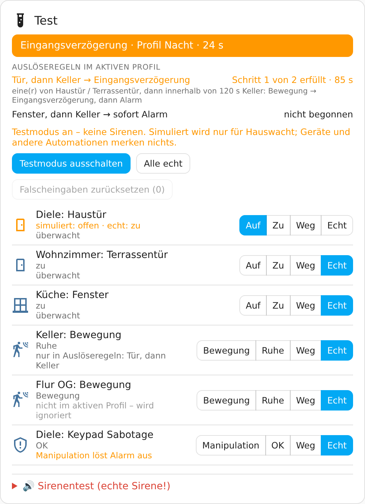

# Testmodus und Testkarte

Im **Testmodus** laufen alle Abläufe wie im Ernstfall – Scharfschalten, Verzögerungen, Alarm,
Benachrichtigungen –, aber:

- **Sirenen werden nie angesteuert**, auch nicht bei freigegebener Hardware. Das ist technisch
  erzwungen, nicht nur angezeigt.
- Alarme sind als Testalarm gekennzeichnet.
- Benachrichtigungen und Ansagen nur, wenn „Auch im Testmodus benachrichtigen“ an ist; der Titel
  beginnt dann mit „[TEST]“, Ansagen mit „Test.“.
- Der Testmodus lässt sich nur umschalten, wenn alle Bereiche unscharf sind. Er bleibt über einen
  Neustart erhalten.

Schalter: `switch.hauswacht_testmodus` oder oben in der Testkarte.

## Karte „Hauswacht Test“



Dashboard bearbeiten → **Karte hinzufügen** → **„Hauswacht Test“** – oder in YAML:

```yaml
type: custom:hauswacht-test-card
title: Test   # optional
```

Die Karte zeigt oben den Zustand der Anlage mit Profil (bei Ein- und Ausgangsverzögerung mit
Countdown), darunter die **Auslöseregeln des aktiven Profils** („nicht begonnen“ oder „Schritt 1
von 2 erfüllt · 85 s“) und **alle Melder** mit Raum, echtem Zustand und Knöpfen:

| Melderart | Knöpfe |
|---|---|
| Tür, Fenster, Öffnung, Garagentor | **Auf** / **Zu** |
| Bewegung, Präsenz, Belegung | **Bewegung** / **Ruhe** |
| Manipulation (Sabotage) | **Manipulation** / **OK** |
| alle | **Weg** (nicht verfügbar), **Echt** (zurück auf den echten Wert) |

Unter jedem Melder steht, was Hauswacht gerade mit ihm macht:

| Hinweis | Bedeutung |
|---|---|
| überwacht | löst im aktiven Profil aus |
| nicht im aktiven Profil | wird ignoriert (z. B. Keller beim Profil „Zuhause“) |
| nur in Auslöseregeln: … | gehört im aktiven Profil nur zu diesen Auslöseregeln |
| überbrückt bis zum Schließen | war beim Beenden eines Alarms offen; erst nach **Zu** wieder überwacht |
| immer aktiv | meldet auch unscharf |
| Manipulation löst Alarm aus / nur Meldung | je nach Profil; unscharf immer nur Meldung |

Oben in der Karte:

- **Testmodus** ein/aus.
- **Alle echt** – setzt alle simulierten Melder zurück.
- **Falscheingaben zurücksetzen (N)** – setzt den Zähler falscher PIN-/Karteneingaben und eine
  laufende [Sperre](benutzer.md#sperre-nach-falschen-eingaben) zurück. Nur für Administratoren,
  nur anklickbar, wenn es Fehlversuche gibt; während einer Sperre steht „gesperrt“ dabei.

## So funktioniert die Simulation

- Simulieren geht **nur im Testmodus**.
- Der simulierte Zustand gilt **nur für Hauswacht**: Scharfschalten, offene Melder,
  Eingangsverzögerung, Alarm, Manipulation, Ausfall – alles wie echt. Das Gerät und sein
  Zustand in Home Assistant bleiben unverändert, **andere Automationen merken nichts**.
- Solange ein Melder simuliert wird, zählt sein echter Zustand für Hauswacht nicht (die Karte
  zeigt ihn trotzdem an). „Echt“ übernimmt den echten Wert – ist das Fenster in Wirklichkeit
  offen und die Anlage scharf, gibt es dann einen Testalarm.
- **Testmodus aus = alles wieder echt.** Nach einem Neustart sind Simulationen ebenfalls weg.

Dasselbe als Aktionen:

```yaml
action: hauswacht.simulate_state
target:
  entity_id: alarm_control_panel.hauswacht
data:
  sensor: binary_sensor.turkontakt_vorne_contact
  state: "on"        # on · off · unavailable · real
```

`hauswacht.simulate_trigger` (Melder kurz auslösen) und `hauswacht.simulate_reset` (alle
zurück) gibt es ebenfalls.

## Sirenentest in der Karte

Ganz unten, **eingeklappt**: „🔊 Sirenentest (echte Sirene!)“. Aufgeklappt zeigt er jede Sirene
mit dem letzten Test. „Testen …“ fragt erst nach („Sirene ertönt jetzt 3 s. Wirklich
starten?“), danach „Gehört? Ja/Nein“.

Das ist **keine Simulation**: Es ertönt die echte Sirene (3 s, leise) – deshalb im Testmodus
gesperrt und nur für Administratoren. Alles Weitere unter [Sirenentest](sirenen.md#sirenentest).

## Ein Testdurchlauf

1. Testmodus an.
2. Profil „Nacht“ scharf schalten → Ausgangsverzögerung läuft ab.
3. Haustür **Auf** → Eingangsverzögerung mit Countdown.
4. Am Keypad oder Bedienfeld unscharf schalten – oder warten: Testalarm, Push mit „[TEST]“,
   keine Sirene.
5. **Alle echt**, Testmodus aus.
