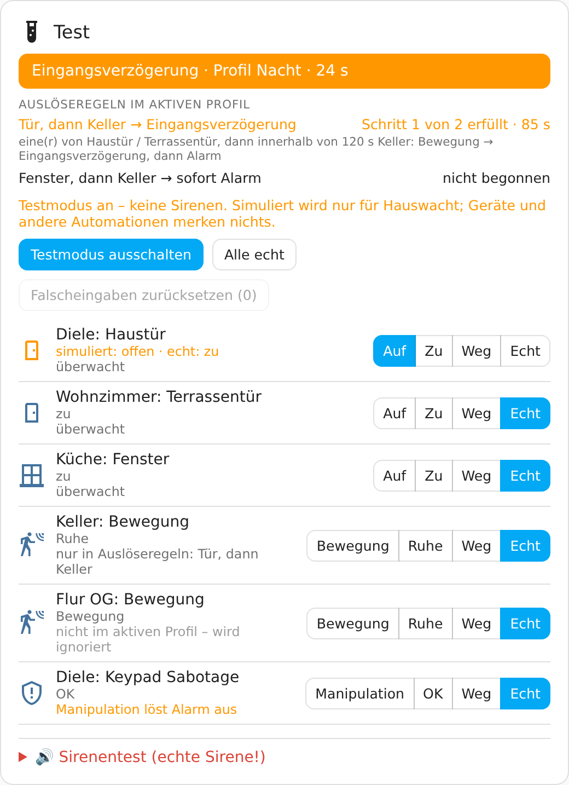

# Testmodus und Testkarte

**Deutsch** | [English](en/test-mode.md)

Im **Testmodus** laufen alle Abläufe wie im Ernstfall – Scharfschalten, Verzögerungen, Alarm,
Benachrichtigungen –, aber:

- **Sirenen werden nie angesteuert**, auch nicht bei freigegebener Hardware. Das ist technisch
  erzwungen, nicht nur angezeigt.
- Alarme sind als Testalarm gekennzeichnet.
- Benachrichtigungen und Ansagen nur, wenn „Auch im Testmodus benachrichtigen“ an ist; der Titel
  beginnt dann mit „[TEST]“, Ansagen mit „Test.“.
- Der Testmodus lässt sich nur umschalten, wenn alle Bereiche unscharf sind. Er bleibt über einen
  Neustart erhalten.

Schalter: `switch.hauswacht_testmodus` oder oben in der Testkarte.

## Karte „Hauswacht Test“



Dashboard bearbeiten → **Karte hinzufügen** → **„Hauswacht Test“** – oder in YAML:

```yaml
type: custom:hauswacht-test-card
title: Test   # optional
```

Die Karte zeigt oben den Zustand der Anlage mit Profil (bei Ein- und Ausgangsverzögerung mit
Countdown), darunter die **Auslöseregeln des aktiven Profils** („nicht begonnen“ oder „Schritt 1
von 2 erfüllt · 85 s“) und **alle Melder** mit Raum, echtem Zustand und Knöpfen:

| Melderart | Knöpfe |
|---|---|
| Tür, Fenster, Öffnung, Garagentor | **Auf** / **Zu** |
| [Melder mit Kippstellung](melder.md#melder-mit-kippstellung-gekippt) | **Auf** / **Gekippt** / **Zu** |
| Bewegung, Präsenz, Belegung | **Bewegung** / **Ruhe** |
| Manipulation (Sabotage) | **Manipulation** / **OK** |
| Erschütterung | **Erschütterung** / **Ruhe** (der Fehlalarmschutz zählt mit) |
| alle | **Weg** (nicht verfügbar), **Echt** (zurück auf den echten Wert) |

Unter jedem Melder steht, was Hauswacht gerade mit ihm macht:

| Hinweis | Bedeutung |
|---|---|
| überwacht | löst im aktiven Profil aus |
| nicht im aktiven Profil | wird ignoriert (z. B. Keller beim Profil „Zuhause“) |
| nur in Auslöseregeln: … | gehört im aktiven Profil nur zu diesen Auslöseregeln |
| überbrückt | war beim Scharfschalten offen („Trotzdem scharf“); bis zum Unscharfschalten nicht überwacht |
| überbrückt bis zum Schließen | war beim Beenden eines Alarms oder nach einem Neustart offen; erst nach **Zu** wieder überwacht |
| immer aktiv | meldet auch unscharf |
| Manipulation löst Alarm aus / nur Meldung | je nach Profil; unscharf immer nur Meldung |

Oben in der Karte:

- **Testmodus** ein/aus.
- **Alle echt** – setzt alle simulierten Melder zurück.
- **Falscheingaben zurücksetzen (N)** – setzt den Zähler falscher PIN-/Karteneingaben und eine
  laufende [Sperre](benutzer.md#sperre-nach-falschen-eingaben) zurück. Nur für Administratoren,
  nur anklickbar, wenn es Fehlversuche gibt; während einer Sperre steht „gesperrt“ dabei.

## So funktioniert die Simulation

- Simulieren geht **nur im Testmodus**.
- Der simulierte Zustand gilt **nur für Hauswacht**: Scharfschalten, offene Melder,
  Eingangsverzögerung, Alarm, Manipulation, Ausfall – alles wie echt. Das Gerät und sein
  Zustand in Home Assistant bleiben unverändert, **andere Automationen merken nichts**.
- Solange ein Melder simuliert wird, zählt sein echter Zustand für Hauswacht nicht (die Karte
  zeigt ihn trotzdem an). „Echt“ übernimmt den echten Wert – ist das Fenster in Wirklichkeit
  offen und die Anlage scharf, gibt es dann einen Testalarm.
- **Testmodus aus = alles wieder echt.** Nach einem Neustart sind Simulationen ebenfalls weg.

Dasselbe als Aktionen:

```yaml
action: hauswacht.simulate_state
target:
  entity_id: alarm_control_panel.hauswacht
data:
  sensor: binary_sensor.turkontakt_vorne_contact
  state: "on"        # on · off · unavailable · real
```

`hauswacht.simulate_trigger` (Melder kurz auslösen) und `hauswacht.simulate_reset` (alle
zurück) gibt es ebenfalls.

## Anwesenheit testen

Die Profil-Automatik schaltet scharf, wenn **alle weg** sind, und unscharf, wenn jemand
**zurückkommt** (siehe [Profile → Automatik](profile.md#automatik)). Damit du das ausprobieren
kannst, ohne wirklich das Haus zu verlassen, zeigt die Testkarte unter den Meldern den Block
**„Anwesenheit“**.

### Was du siehst (immer, auch ohne Testmodus)

Pro Person eine Zeile: **zuhause**, **weg** oder **unbekannt** – und warum. Beispiele:

| Anzeige | Bedeutung |
|---|---|
| Niklas: **zuhause** – zuhause laut: Niklas iPhone WLAN | Mindestens ein Signal sagt „zuhause“. |
| Finja: **weg** – Beleg: frische Ortung außerhalb (14:32) | Eine frische, genaue Ortung liegt außerhalb der Heimzone. |
| Martin: **weg** – Beleg: Tür + Signal (unsicher) | Tür ging auf, danach meldete das Signal „weg“ (nur, wenn für ihn erlaubt). |
| Niklas: **zuhause** – alle Signale „weg“, aber kein Beleg | Alles sagt „weg“, aber es gibt keinen Beleg. Für Hauswacht zählt er weiter als **nicht weg**. |
| Finja: **unbekannt** – unklar: Finja iPhone | Ein Signal liefert gerade nichts Brauchbares. |

Darüber steht **pro Profil mit Automatik oder „Bei Rückkehr“** eine Zeile, was gerade los ist:

| Anzeige | Bedeutung |
|---|---|
| **Abwesend** – wird scharf, wenn alle weg sind. Noch nicht weg: Niklas, Finja | Die Automatik wartet. Diese Personen gelten noch nicht als weg. |
| **Abwesend** – alle weg, wird scharf in 4:12 | Alle sind weg, die Wartezeit läuft. Danach wird das Profil eingeschaltet. |
| **Abwesend** – ist scharf (automatisch). Bei Rückkehr: unscharf mit Türbeleg | Das Profil ist scharf. „(automatisch)“ heißt: die Automatik hat es eingeschaltet. |
| **Abwesend** – ist scharf. Bei Rückkehr: unscharf mit Türbeleg – Heimkehr erkannt, wartet auf die Tür (noch 4:30) | Jemand ist heimgekommen. Geht innerhalb der Zeit eine Eingangstür auf, wird unscharf geschaltet. |
| **Abwesend** – Eingangsverzögerung läuft. Bei Rückkehr: … – Tür gesehen, wartet auf eine Heimkehr (noch 4:50) | Die Tür ging auf. Kommt innerhalb der Zeit jemand aus der Liste heim, wird unscharf geschaltet. |
| **Abwesend** – ist scharf. Bei Rückkehr: unscharf, nur wenn automatisch scharf – greift jetzt nicht, weil von Hand scharf geschaltet | Bei dieser Einstellung schaltet eine Heimkehr nur ab, wenn die Automatik scharf geschaltet hat. |
| **Abwesend** – nicht nötig, „Nacht“ ist scharf | Ein anderes Profil ist scharf. Die Automatik schaltet nie über ein anderes Profil hinweg. |

Denselben Stand findest du auf der Einstellungsseite unter **System → Anwesenheit**
(„Wer gilt gerade als zuhause?“). Dort ist es der Stand beim Öffnen der Seite.

### Anwesenheit simulieren (nur im Testmodus)

Im Testmodus hat jede Person diese Knöpfe:

| Knopf | Was Hauswacht dann annimmt |
|---|---|
| **Zuhause** | Die Person ist zuhause. |
| **Weg** | Die Person ist weg **und** es gibt einen Beleg. Zählt für „alle weg“. |
| **Weg ohne Beleg** | Alle Signale sagen „weg“, aber ohne Beleg. Zählt **nicht** als weg – so prüfst du, dass Hauswacht nicht vorschnell scharf schaltet. |
| **Nähert sich** | Die Person ist weg und kommt gerade zurück. Damit testest du „Bei Rückkehr“ und die längere Eingangsverzögerung beim Annähern. |
| **Echt** | Simulation für diese Person aus – es gilt wieder der echte Stand. |

Der aktive Knopf ist hervorgehoben. Wie bei den Meldern gilt: **Die Simulation wirkt nur in
Hauswacht.** Die Personen in Home Assistant und alle anderen Automationen bleiben unverändert.
**Testmodus aus** oder ein **Neustart** setzt alles auf „Echt“ zurück.

**Simulierte Türen zählen wie echte:** Stellst du im Testmodus eine Eingangstür in der Karte
auf **Auf** (oder löst sie kurz aus), gilt das auch für „Bei Rückkehr“ (Türbeleg, Durchgang)
und als Beleg für „weg“ (Tür + Signal). So lässt sich die ganze Heimkehr durchspielen.

Die Wartezeit von „alle weg“ wird **nicht** verkürzt – die Anlage verhält sich genau wie im
echten Betrieb. Damit du nicht warten musst, gibt es während der Wartezeit den Knopf
**„Wartezeit überspringen“**: Er beendet die Wartezeit sofort, als wäre sie abgelaufen.

**Beispiel – scharf schalten, wenn alle weg sind:**

1. Testmodus an.
2. Bei allen Personen **Weg** drücken → beim Profil steht „alle weg, wird scharf in …“.
3. **Wartezeit überspringen** → das Profil wird scharf geschaltet (Testmodus: keine Sirene).
4. Heimkehr mit „Bei Rückkehr: unscharf mit Türbeleg“: Haustür in der Karte **Auf** →
   Eingangsverzögerung läuft, beim Profil steht „Tür gesehen, wartet auf eine Heimkehr“.
   Dann bei dir **Zuhause** drücken → unscharf. Die Reihenfolge ist egal: erst **Zuhause**,
   dann die Tür geht genauso.
5. Mit **Nähert sich** vor der Tür testest du die längere Eingangsverzögerung beim Annähern.
6. Testmodus aus → alles wieder echt.

**Beispiel – kein Beleg:** Alle auf **Weg ohne Beleg** → beim Profil steht weiter „Noch nicht weg: …“.
Genau so soll es sein: Ohne Beleg wird nicht automatisch scharf geschaltet.

Noch nicht simulierbar sind zeitgesteuerte Automatiken (Uhrzeit).

Dasselbe als Aktionen:

```yaml
action: hauswacht.simulate_presence
target:
  entity_id: alarm_control_panel.hauswacht
data:
  person: person.niklas
  state: away        # home · away · away_no_proof · approaching · real
```

```yaml
action: hauswacht.skip_wait
target:
  entity_id: alarm_control_panel.hauswacht
```

## Sirenentest in der Karte

Ganz unten, **eingeklappt**: „🔊 Sirenentest (echte Sirene!)“. Aufgeklappt zeigt er jede Sirene
mit dem letzten Test. „Testen …“ fragt erst nach („Sirene ertönt jetzt 3 s. Wirklich
starten?“), danach „Gehört? Ja/Nein“.

Das ist **keine Simulation**: Es ertönt die echte Sirene (3 s, leise) – deshalb im Testmodus
gesperrt und nur für Administratoren. Alles Weitere unter [Sirenentest](sirenen.md#sirenentest).

## Ein Testdurchlauf

1. Testmodus an.
2. Profil „Nacht“ scharf schalten → Ausgangsverzögerung läuft ab.
3. Haustür **Auf** → Eingangsverzögerung mit Countdown.
4. Am Keypad oder Bedienfeld unscharf schalten – oder warten: Testalarm, Push mit „[TEST]“,
   keine Sirene.
5. **Alle echt**, Testmodus aus.
