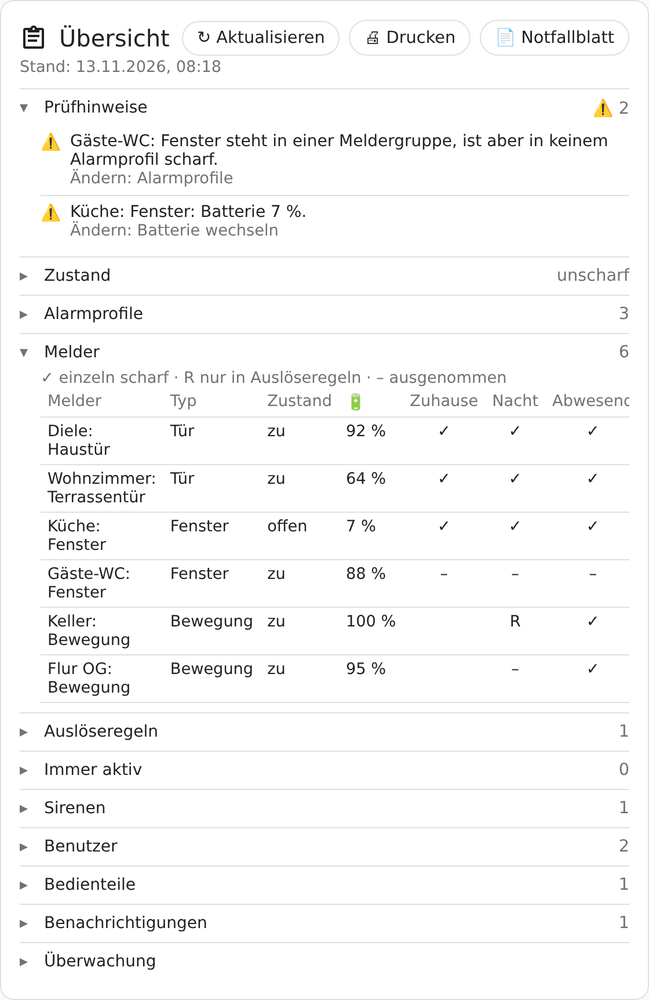

# Anlagenübersicht, Prüfhinweise und Diagnose

## Karte „Hauswacht Übersicht“



Die ganze Konfiguration der Anlage auf einen Blick – **wer, was, wann, wieso**. Nur für
Administratoren; andere Benutzer sehen den Hinweis „Die Übersicht ist nur für Administratoren“.

Dashboard bearbeiten → **Karte hinzufügen** → **„Hauswacht Übersicht“** – oder in YAML:

```yaml
type: custom:hauswacht-uebersicht-card
title: Übersicht   # optional
```

**Am Bildschirm** eine Kurzfassung mit aufklappbaren Abschnitten:

| Abschnitt | Inhalt |
|---|---|
| **Prüfhinweise** | ganz oben, siehe [unten](#prüfhinweise) – bei Warnungen schon aufgeklappt |
| Zustand | je Bereich, Testmodus, Sirenen freigegeben, Systemstatus, falsche Eingaben |
| Alarmprofile | je Profil: Knopf, Meldergruppen, Ausnahmen, Auslöseregeln, Zeiten, Verhalten, Sirenen, Empfänger, Automatik, Scharf durch Schließen |
| Melder | Tabelle **Melder × Profil**: ✓ einzeln scharf, R nur in Auslöseregeln, – ausgenommen; dazu Typ, Zustand, Batterie |
| Auslöseregeln | im Klartext, mit den Profilen, die sie verwenden |
| Immer aktiv, Sirenen | Melder und Sirenen; was jede Sirene kann, letzter Test |
| Benutzer | PIN ja/nein, Karten (gekürzt), Rechte je Bereich, Gültigkeit; PIN-Regeln |
| Bedienteile | Keypads mit Tastenbelegung, Aufkleber und Leser mit Aktion |
| Benachrichtigungen | Empfänger je Ereignis, Ansagen, Nachtruhe |
| Überwachung | Funkstille-Grenze mit Empfehlung, Funknetz und Gateways, Anlernzeit, Heimkehr-Beobachtung mit [Download](beobachtung.md) von Bericht und Tabelle |

Die Karte lädt die Daten beim Öffnen; **Aktualisieren** holt den neuesten Stand.

### Drucken

**Drucken** erstellt das **volle Programm** als A4-Seiten (schwarz-weiß, alle Abschnitte
ausgeklappt, Melder-Tabelle mit letztem Kontakt) und öffnet den Druckdialog des Browsers – dort
geht auch „Als PDF speichern“. Gedruckt wird nur die Übersicht, nicht das Dashboard.

> Der Ausdruck enthält Sicherheitsinformationen, z. B. welche Fenster nachts nicht überwacht
> werden. Das steht auch oben auf dem Blatt – nicht offen liegen lassen.

### Notfallblatt

**Notfallblatt** druckt eine Seite für Familie und Gäste, z. B. für den Schrank neben dem Keypad:
scharf und unscharf schalten (Keypad, App), welche Profile es gibt, wie viel Zeit nach dem
Öffnen der Tür bleibt, was bei einem Alarm passiert, wer benachrichtigt wird und was bei Brand
gilt. Ohne Technik und ohne Sicherheitsdetails.

### Was nie in der Übersicht steht

- **PINs** – auch keine Teile oder Hashes; nur „PIN: ja/nein“.
- **Kartennummern** nur gekürzt („…2880“).
- **Bedrohungs-PIN:** Wer einen hat, geht aus der Übersicht nicht hervor. Nur wenn er ohne
  Empfänger wirkungslos wäre, gibt es einen Prüfhinweis – ohne Namen.

## Prüfhinweise

Hauswacht schaut die eigene Konfiguration kritisch an und meldet Lücken, Vergessenes und
Widersprüche. Jeder Hinweis sagt, **wo** man es ändert.

| Hinweis | Art |
|---|---|
| Profil ohne Sirene **und** ohne Empfänger – ein Alarm erreicht niemanden | ⚠️ wichtig |
| Bedrohungs-PIN eingerichtet, aber keine Empfänger | ⚠️ wichtig |
| Melder **seit mehr als 24 Stunden** nicht verfügbar | ⚠️ wichtig |
| Testmodus an | ⚠️ |
| Profil ohne Meldergruppen und ohne Auslöseregeln | ⚠️ |
| Melder in einer Meldergruppe, aber in keinem Profil scharf (auch nicht in einer Regel) | ⚠️ |
| Melder nicht verfügbar (kürzer als 24 h) | ⚠️ |
| Batterie unter 10 % | ⚠️ |
| Sirene beim letzten Test nicht gehört | ⚠️ |
| Störung eines überwachten Funknetzes/Gateways | ⚠️ |
| Profil ohne Sirene (nur Benachrichtigung) | ℹ️ |
| Sirenen in Profilen, aber noch nicht freigegeben | ℹ️ |
| Sirene nie getestet oder letzter Test älter als ein halbes Jahr | ℹ️ |
| Benutzer ohne PIN, während andere einen haben | ℹ️ |
| Gast mit abgelaufener Gültigkeit | ℹ️ |
| Funkstille-Erkennung aus bzw. knapper als empfohlen | ℹ️ |
| Kein Funknetz/Gateway überwacht | ℹ️ |
| Auslöseregel, die kein Profil verwendet | ℹ️ |

Melder vom Typ **Technik** und immer aktive Melder gelten nicht als „ungenutzt“.

### Als Reparatur in Home Assistant

Die **wichtigen** Hinweise erscheinen zusätzlich unter **Einstellungen → Reparaturen** (mit
Zähler in der Seitenleiste) – so fallen sie auf, ohne dass man die Übersicht öffnet. Alles
andere steht nur in der Übersicht, damit die Reparaturliste nicht zugemüllt wird.

- Geprüft wird zwei Minuten nach dem Start und danach stündlich.
- Ist etwas behoben, verschwindet der Hinweis bei der nächsten Prüfung von selbst.
- Einen Hinweis kann man in Home Assistant auch „ignorieren“.

Batterien meldet Hauswacht nur in der Übersicht – für Benachrichtigungen über schwache Batterien
gibt es bessere Werkzeuge (z. B. Battery Notes).

## Diagnose-Datei für Fehlerberichte

Einstellungen → Geräte & Dienste → Hauswacht → ⋮ → **Diagnose herunterladen** liefert eine
Datei (JSON) mit den Einstellungen und der Übersicht. Zum Lesen ist sie nicht gedacht, sondern
zum **Anhängen an ein [Issue](https://github.com/schlusenbaum/hauswacht/issues)**: Wer sie sieht,
kennt die genaue Einstellung, ohne zehnmal nachzufragen.

Vor dem Erstellen entfernt Hauswacht automatisch: PINs und ihre Hashes, Kartennummern, die
Benutzerliste, Empfänger, Personen, Lautsprecher, WLAN-Namen, MQTT-Topics und Geräte-IDs von
Lesern. Melder- und Profilnamen bleiben drin – bitte vor dem Hochladen kurz drüberschauen.
